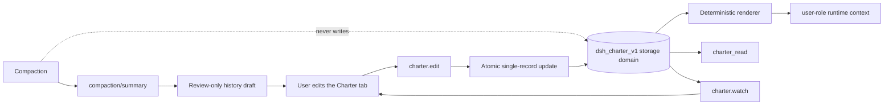

# dsh-charter

[](LICENSE)
[](https://github.com/centella-cream/dsh-charter)
[](docs/design/compatibility.md)
[](package.json)
[](#status)

English | [中文](README.zh.md)

> **Compaction rewrites history. Your commitments don't.**

`dsh-charter` is a durable, user-owned task contract for
[DeepSeek Harness](https://github.com/deepseek-ai/deepseek-harness). Goals, hard constraints, and
deliverables stay visible across context compaction — and remain editable at any time.


Dark theme and narrow-layout evidence: [dark](docs/assets/charter-pane.dark.png), [narrow](docs/assets/charter-pane.narrow.png).

> A real English Web profile with `dsh-context` installed. The tab order is Chat, Trajectory, Context, Fleet,
> then Charter; every pane string follows the active DSH language.

## Contents

- [Why](#why)
- [Highlights](#highlights)
- [How it works](#how-it-works)
- [Install](#install)
- [Quick start](#quick-start)
- [The Charter tab](#the-charter-tab)
- [Configuration](#configuration)
- [Compatibility](#compatibility)
- [Security and privacy](#security-and-privacy)
- [Development](#development)
- [Documentation](#documentation)
- [Acknowledgements](#acknowledgements)
- [Contributing](#contributing)
- [License](#license)

## Why

Compaction replaces older history with a summary. A summary can keep the general task while quietly dropping
standing constraints such as *“do not touch migrations/”*, *“run tests before delivery”*, or *“keep the API
backward compatible”*. Promoting those constraints to the system prompt would instead cross the user-content
permission boundary.

`dsh-charter` solves a narrow problem well:

- **Independent authority.** One `dsh-storage-domain` record per Session is the only authoritative source.
  Compaction summaries and UI caches are never writers or recovery sources.
- **User role by construction.** Editable user text enters `systemPrompt.context()`, never a system-role
  message. The model can read the charter through `charter_read`; it cannot write it.
- **Deterministic rebuild.** The same record revision and renderer version produce byte-identical context.
  `{{...}}` runs are escaped so older DSH prompt interpolators cannot rewrite user text.
- **Explicit budgets.** The tab shows a live context meter and per-field byte counters. Overflow is rejected
  or surfaced for selection — never silently truncated.
- **Atomic Apply.** One edit commits completely or not at all, with revision conflicts and idempotent retries.
- **Safe onboarding.** An existing compacted Session gets a review-only history draft from its latest compaction
  summary; nothing becomes effective until you review and apply it.
- **Drafts survive navigation.** Staged edits, an open inline editor, and a reviewed history draft belong to the
  Session, not to the mounted tab, so checking the conversation and coming back does not lose work.
- **Fail closed and degrade per Session.** One stored record that loads but fails the strict inner schema or
  consistency checks disables only that Session (its raw bytes are preserved for diagnosis); a charter that
  exceeds a later-tightened budget is shown as over-budget instead of corrupt, is not injected, and can be shrunk
  back into range. An **unreadable outer JSON record** is a documented residual risk: the JSON storage backend
  treats it as absent and the plugin cannot distinguish it from a missing record (verification §4.5).
- **Recoverable applies.** A retry reuses the mutation id of an unknown-outcome request, and a revision
  conflict offers an explicit apply-to-latest action instead of discarding the draft.
- **Visible build identity.** The Charter header shows the installed plugin version beside the revision and
  item counts, so a screenshot or support report identifies the build. A regression test fails if the
  client-side constant drifts from `package.json`.

A charter is a declaration, not an enforcement policy. Use Host permissions, sandbox policy, hooks, or
execution guards for restrictions that must be machine-enforced.

## Highlights

- Separate original and current objective; ordinary edits never rewrite the original.
- `invariant` and `deliverable` items with orthogonal review, lifecycle, verification, and progress state.
- A localised conversation-view tab registered once at a stable high order (1000), so it follows Chat, Trajectory,
  and common plugin tabs without re-registering itself.
- A compact, navigable pane: **Overview / Objective / Invariants / Deliverables / History / Context**.
- Sticky Preview / Discard / Apply toolbar and an exact preview of the model-visible user-role context.
- History draft extraction from `compaction/summary`; deterministic, no model call, no automatic write.
- English/Chinese UI, light/dark themes, keyboard focus states, and container-query responsiveness.
- Self-explaining navigation (`rc.6`, unreleased): every section has a hover/focus `?` help badge with a one-sentence purpose.
- Context preview in Formatted JSON or Exact text mode (`rc.6`, unreleased); formatted JSON is for reading, exact bytes remain visible.
- Read-only `charter_read` tool with a compact standing projection; one-time fork copy; explicit degraded
  states across restart, compaction, unload, corrupted records, and over-budget configurations.

## How it works



The Host service initializes a record on `session/created` and before the first prompt on `agent/created`.
The browser registers a `conversation.view` entry; the pane and `charter.watch` use the same revisioned view.
`charter.bootstrap` reads the latest usable compaction summary and returns a draft only — it does not write storage.

## Install

### Current release state

- **Latest published RC:** `0.1.0-rc.4` (npm `latest` and `next`, GitHub Release).
- **Finalized but npm-delayed:** `0.1.0-rc.5` is tagged (`v0.1.0-rc.5`) with a green candidate and immutable
  artifact digest. Its npm publication and GitHub prerelease are deferred; it is not installable from npm yet.
- **Active source:** `0.1.0-rc.6`, unreleased and untagged. It contains DSH `0.2.1-rc.5` compatibility,
  navigation help, formatted preview, and observability work, not a published runtime change.
- `0.1.0-rc.5` adds review, recovery, accessibility, and release-evidence hardening; it is not a new 0.2
  capability line.

Install the latest published version for normal use. Do not assume `dsh-charter@0.1.0-rc.5` or rc.6 resolves
from the registry; the latest published RC remains rc.4.
Our channel policy is to publish RCs under `next` and to point `latest` at the newest RC until a stable release
exists (npm keeps a `latest` tag and we choose where it points; this is our policy, not an npm requirement).

The full recovery/record-health contract is in the [user guide](docs/user-guide.md) and the
[verification record](docs/verification.md). In short, records use a structured health state; export/restore is
owner-only on DSH `0.2.1+`, healthy records are not overwritten, and a rejected write fences only that Session
until a Host restart.

> **Pin an exact version for npm/CLI installation.** pnpm 11+ applies a default `minimumReleaseAge` of 1440
> minutes (24 hours) before resolving a newly published release. During that window, unversioned resolution
> (`dsh-charter`, `@next`, or `@latest`) can select an older release that does not declare compatibility with the
> current DSH runtime, and DSH will reject it. An exact published version does not use that unversioned resolution
> path. Do not bypass the compatibility gate with an exact-version exemption for an older, undeclared release.

### Requirements

- DSH: only the versions listed in the [compatibility matrix](docs/design/compatibility.md) are supported
  (`0.1.7-rc.2`, `0.2.0-rc.1`/`rc.2`, `0.2.1-rc.1`/`rc.2`/`rc.3`/`rc.4`/`rc.5`). Newer stable/RC versions are not claimed until the
  matrix is extended; `0.2.1+` is required for per-Peer Remote resource authorization.
  DSH `0.2.1-rc.5` is source-level support in the unreleased rc.6 tree; published rc.4 and finalized rc.5
  artifacts do not declare it. Do not install rc.4 on DSH rc.5.
- Node.js **`^22.19.0 || >=24.0.0`**.
- A Web or Desktop profile.

### Install from npm (recommended)

#### Web profile — install an exact version

```bash
# Pin the latest published RC; required when it is inside pnpm's release-age window.
dsh plugin --profile web add dsh-charter@0.1.0-rc.4
```

> rc.4 defaults all history candidates but renders only the first 40. Do not apply a draft with more than 40
> candidates. rc.5 is not yet installable from npm.

Pin an exact version for reproducible profiles. `@next` and `@latest` follow dist-tags but are still subject to
pnpm's release-age policy, so they are not a reliable way to install a freshly published RC. If the registry is
unreachable, or you need the exact release artifact, use the offline tarball fallback below.

`dsh-charter@0.1.0-rc.5` is **not yet installable from npm** (finalized, npm publication deferred), and rc.6 has
no tagged candidate yet. Wait for publication before switching a user profile.

Restart `dsh web` (or let profile HMR recompose), then refresh the page. The profile's `package.json` gains the
dependency and bundle entry.

#### Desktop — install through Plugins

Open **Desktop → Plugins** and use **Install**/**Update** for `dsh-charter`. The current Desktop Plugins UI does
not accept an exact npm version spec; it resolves the package through its plugin catalog. Consequently, when a
new release is still inside pnpm's release-age window, the catalog can initially resolve an older release that
the DSH compatibility gate rejects. In that case, wait until the target release is outside the release-age
window and retry **Install**/**Update**. Do not disable the policy or grant an exact-version exemption to force
an older, undeclared release.

For an immediate or exact install, use the offline tarball fallback below if your Desktop build supports
importing a local plugin. Otherwise, the Plugins UI is the only supported Desktop installation path. Desktop
owns the plugin lifecycle and hot-applies the new bundle. Web and Desktop consume the same `dsh.client`
web bundle through the host client-module carrier; there is no separate Desktop client entry. The Desktop app
runtime must itself be one of the declared DSH versions.

### Offline / local tarball fallback

Use this path as a backup for air-gapped machines, exact-artifact verification, or Desktop builds that support
importing a local plugin. Published releases ship the same tarball and `SHA256SUMS` used by `npm publish`.

```bash
# Published rc.4 artifact (same bytes as the GitHub Release):
gh release download v0.1.0-rc.4 --pattern '*.tgz' --pattern SHA256SUMS
shasum -a 256 -c SHA256SUMS
dsh plugin --profile web add ./dsh-charter-0.1.0-rc.4.tgz
```

The finalized rc.5 candidate can be inspected from its tag as release evidence, not as a normal user install:

```bash
git checkout v0.1.0-rc.5
npm install && npm run build && npm pack
dsh plugin --profile web add ./dsh-charter-0.1.0-rc.5.tgz
```

The active rc.6 tree has no tagged candidate; do not distribute a locally built rc.6 tarball before a candidate
and release evidence exist.

`dsh plugin --profile desktop` is intentionally refused by the Electron app that owns that profile; use the
Desktop Plugins page or that profile's package manager. Source-level development is described in
[CONTRIBUTING.md](CONTRIBUTING.md); do not use `git clone` as the normal installation method.

### Update

- **Web (npm):** install the exact published target version, e.g.
  `dsh plugin --profile web add dsh-charter@0.1.0-rc.4`, then restart/refresh. Pinned profiles keep their
  explicit version entry. Do not use a bare `@next`/`@latest` immediately after a release; pnpm's release-age
  policy can resolve an older version. Switch to rc.5 only after npm publication.
- **Local tarball:** rebuild/download the new tarball and repeat the local install command; this bypasses
  registry release-age resolution.
- **Desktop:** use **Plugins → Install/Update**. The UI has no exact npm version selector, so it follows the
  catalog and the release-age policy. If it resolves an older release that the compatibility gate rejects, wait
  until the target release matures and retry, or use the offline tarball fallback if your build supports local
  plugin import. Desktop hot-applies the new bundle.

## Quick start

### Bring an existing compacted Session

1. Open an old Session that has already been compacted **and is live in this Web process**.
2. Open the **Charter** tab. If its charter is empty, the plugin reads the latest `compaction/summary` and shows a
   **History draft** tab.
3. Review or edit the candidates, uncheck anything stale, and click **Apply draft**. Only then does the content
   become effective and enter the next model request.

History extraction is deterministic and heuristic: it selects high-signal sections and splits long candidates
instead of truncating them. The review step is intentionally mandatory.

### Start a new charter

1. Open **Charter** in a started Session.
2. Set the objective.
3. Add invariants and deliverables in their sections.
4. Use **Preview context** to inspect the exact user-role text and byte count.
5. Click **Apply**. A revision conflict preserves your draft and shows the server revision.

## The Charter tab

The tab is opened from the conversation header; it is registered once at a stable high order (1000), so it follows
Chat, Trajectory, and common plugin tabs without re-registering itself. The pane
has a left section navigation on wide screens and a horizontal tab strip on narrow screens:

| Section | Purpose |
| --- | --- |
| **Overview** | Objective summary, invariant/deliverable cards, budget, history-draft callout |
| **Objective** | Edit or redirect the objective; the original is immutable |
| **Invariants** | Add, edit, replace, archive, purge, and verify hard constraints |
| **Deliverables** | Same actions plus delivery progress |
| **History** | Always available: apply a draft extracted from the latest usable compaction summary, or inspect the current bootstrap phase and re-check |
| **Context** | Exact user-role runtime context, bytes, and limits |

While the Charter view is active it owns the whole reading surface: the chat composer is hidden, and its
draft returns untouched when you switch back to **Chat**. Approval/question/plan-review seats stay visible.

When a history draft has more candidates than the context budget can hold, the extra candidates are imported as
**pending proposals** in the same atomic Apply. They remain visible and reviewable; nothing is rejected because
of an arbitrary per-kind active-count cap.

Budgets are visible everywhere. Long draft items become multiple candidates; over-limit fields are highlighted.
The charter-context budget is the gate: when a history draft does not fit, the remaining candidates become pending
proposals instead of blocking the whole import. Apply is disabled only for real field, storage, or atomic limits.

## Configuration

Defaults live in `cordis.patch.yml`. Override them in the profile patch:

```yaml
- id: charter
  config:
    maxPromptBytes: 8192
    maxObjectiveBytes: 4096
    maxItemBytes: 1024
    contextOrder: 130
```

| Field | Default | Meaning |
| --- | ---: | --- |
| `maxPromptBytes` | 8192 | UTF-8 budget for the charter contribution only (excludes history, system, tools, and other contexts) |
| `maxObjectiveBytes` | 4096 | UTF-8 budget for the objective |
| `maxItemBytes` | 1024 | per-item text budget |
| `maxItems` | 512 | all-items storage limit |
| `maxPendingItems` | 512 | pending-proposal limit |
| `maxOps` | 1024 | operations per Apply |
| `maxRecordBytes` | 1048576 | one Session record |
| `historyLimit` | 64 | recent history receipts |
| `maxHistoryBytes` | 131072 | recent history bytes |
| `mutationLimit` | 128 | recent mutation receipts |
| `maintenanceLimit` | 16 | recent initialize/restore receipts (min 1) |
| `maxRecoveryBytes` | 4194304 | complete recovery-archive budget (≥ record budget + 64 KiB, 16 MiB ceiling) |
| `contextOrder` | 130 | runtime-context order; after sandbox/approval/subagent by default |

The only model-visible capacity is `maxPromptBytes`; active invariants and deliverables are not capped
separately. `maxItems` and `maxPendingItems` bound storage. When a history draft does not fit the context
budget, the candidates that fit are imported as active and the rest become pending proposals — not rejected,
truncated, or silently dropped.

## Compatibility

| DSH version | Status |
| --- | --- |
| `0.1.7-rc.2` | Supported (minimum) |
| `0.2.0-rc.1` / `0.2.0-rc.2` | Supported |
| `0.2.1-rc.1` / `0.2.1-rc.2` / `0.2.1-rc.3` / `0.2.1-rc.4` / `0.2.1-rc.5` | Supported (primary baseline: `0.2.1-rc.5`) |
| `0.1.5-rc.1` and earlier | Not supported |
| `0.2.2-rc.x`, `0.3.x` | Not declared until verified |

Supported" means typecheck, build, tests, and Remote/client smoke for that version. Fresh Web profile install,
startup, page, and client-bundle checks passed on `0.1.7-rc.2`, `0.2.0-rc.2`, `0.2.1-rc.2`, `0.2.1-rc.4`, and `0.2.1-rc.5`;
other versions are API/build verified. Real-model compaction end-to-end is a documented manual check (`npm run verify:compaction`, section 8 of the current verification record); a **PASS is recorded in the immutable [v0.1.0-rc.4 verification §8.4](https://github.com/centella-cream/dsh-charter/blob/v0.1.0-rc.4/docs/verification.md#84-recorded-real-model-run-2026-10-22)**.
The full matrix and degradation notes are in the [compatibility document](docs/design/compatibility.md).
`0.1.7`/`0.2.0` have no per-Peer Remote resource authorization; use them only in a trusted single-operator
environment.

## Security and privacy

- User-authored text never enters a system-role message.
- The model has no charter write capability; `charter_read` is read-only. Its `standing` view returns the complete
  current working set (bounded by record quotas) in a compact form that omits debug-only ids/review/lifecycle, so
  metadata cannot inflate the tool result; there is no fixed byte cap on `standing`, so a maximum-size charter can
  produce a large tool result. The `all` debug page is capped at 64 items / 32 KiB (final envelope) and reports
  omitted items; paging `standing` is a documented follow-up.
- Actor policy: `owner` may perform all edits including purge; `user` may perform ordinary edits but not purge;
  `host` is rejected on the Remote edit path. Records are bound to `createdAt`, `cwd`, and `parentSession`;
  reusing a Session id across lifecycles is rejected.
- Ordinary logs contain stable ids, kinds, revisions, and error codes — not user body text.
- A charter is not a permission system. See [SECURITY.md](SECURITY.md) for the threat model and reporting path.

## Development

```bash
npm run typecheck        # strict TS
npm test                 # build + Vitest
npm run build            # Host ESM + single-file browser bundle + smoke
npm run check            # typecheck + build + tests
npm run smoke:package    # packed tarball installability
npm run verify:compaction # manual real-model compaction check (not part of check)
```

The test suite covers the pure core, real Host composition, storage-domain behavior, Remote framing,
history extraction, client state, and factory-bundle registration. The current tree has **379 tests**; the eight-version matrix passes on all declared DSH versions. See the [verification record](docs/verification.md) for the current evidence.

## Acknowledgements

The design research for this project benefited from two independent community projects:

- [dsh-context-enhancement](https://github.com/chuxindd/dsh-context-enhancement) — per-record storage,
  Session lifecycle fencing, durable publish ordering, and revision conflict handling.
- [dsh-ontology](https://www.npmjs.com/package/dsh-ontology) — a pure domain kernel, stable error codes, and
  overlay validation before writes.

Their ideas informed the design review; no source code is copied, and these projects do not endorse
`dsh-charter`. See the [research notes](docs/research/charter-research.md) for the detailed comparison.

## Documentation

- [Design specification](docs/design/charter-design.md)
- [User and operator guide](docs/user-guide.md)
- [Compatibility matrix](docs/design/compatibility.md)
- [Verification record](docs/verification.md)
- [Release notes](docs/release-notes/README.md)
- [Version roadmap](docs/design/version-roadmap.md)
- [Release checklist](docs/releasing.md)
- Historical design/research notes remain under `docs/design/` and `docs/research/` but are not current
  operating instructions.

Every long-form document has an English and Chinese version, linked at the top of each page.

## Contributing

Issues and pull requests are welcome. Please read [CONTRIBUTING.md](CONTRIBUTING.md) and the
[Code of Conduct](CODE_OF_CONDUCT.md) before changing the Host contract, prompt boundary, or client bundle. For
security reports, follow [SECURITY.md](SECURITY.md).

## Status

Pre-1.0. The DSH plugin ABI is still moving; compatibility is tested against the eight versions above, and the
design keeps the compatibility layer deliberately small.

Current release state (2026-10-30):

- **Published:** `0.1.0-rc.4` — npm `latest`/`next`, GitHub Release, immutable tag.
- **Finalized, npm-delayed:** `0.1.0-rc.5` — candidate green, exact artifact SHA-256
  `94e27acf8851ad5423defd06a41253171317f4e805af809fe8e8e7a9ce83a939`, tag `v0.1.0-rc.5` at the
  checksum-only C+1 commit. No npm version or GitHub Release yet.
- **Active, unpublished:** `0.1.0-rc.6` — documentation, UI help/preview, and traffic observation only so far; not tagged and not
  built as a release candidate.
- **Pending for rc.5:** npm token publication, GitHub prerelease, protected browser evidence, and Promotion.
  The repository `main` includes the token-publish workflow.
- The real-model compaction acceptance PASS remains recorded on the immutable
  [v0.1.0-rc.4 verification §8.4](https://github.com/centella-cream/dsh-charter/blob/v0.1.0-rc.4/docs/verification.md#84-recorded-real-model-run-2026-10-22).

CI (`.github/workflows/ci.yml`) packs and smoke-tests the installable artifact on Node `22.19.0` and `24`;
release candidate, browser evidence, and promotion workflows are separate gates. Do not infer a publication
from a green candidate.


## License

[MIT](LICENSE) © 2026 dsh-charter contributors.
