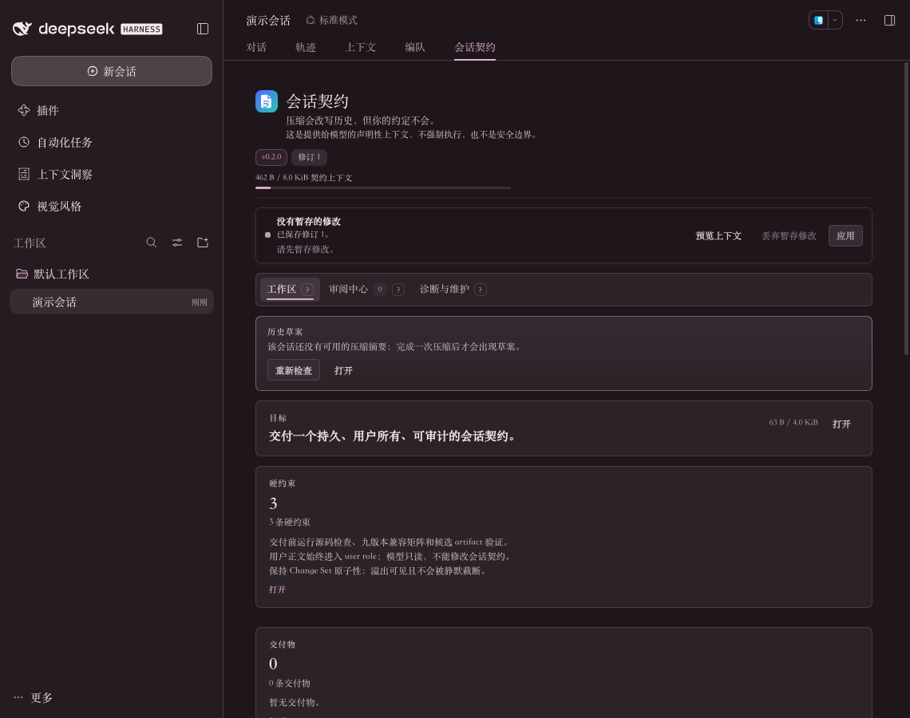
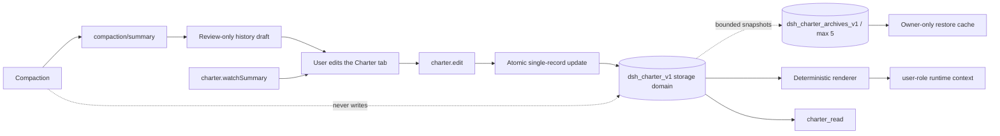

# dsh-charter

[](LICENSE)
[](https://github.com/centella-cream/dsh-charter)
[](docs/design/compatibility.md)
[](package.json)
[](#status)

English | [中文](README.zh.md)

> **Compaction rewrites history. Your commitments don't.**

`dsh-charter` is a durable, user-owned session contract for
[DeepSeek Harness](https://github.com/deepseek-ai/deepseek-harness). Goals, hard constraints,
deliverables, evidence, and dependency relationships survive compaction and remain visible and editable.



> The current **0.2** Pane in a local Web profile. UI strings follow the active DSH language; this image uses
> demo values so no private Session content is published.

## Contents

- [Status](#status)
- [Why](#why)
- [0.2 headline: constraint relationships](#02-headline-constraint-relationships)
- [Other 0.2 capabilities](#other-02-capabilities)
- [How it works](#how-it-works)
- [Install](#install)
- [Quick start](#quick-start)
- [The Charter tab](#the-charter-tab)
- [Configuration](#configuration)
- [Compatibility](#compatibility)
- [Security and privacy](#security-and-privacy)
- [Development](#development)
- [Documentation](#documentation)
- [Contributing](#contributing)
- [License](#license)

## Status

- **Published release:** `0.2.0` — npm `latest` and `next`, GitHub Release `v0.2.0`.
- **Previous release:** `0.1.0-rc.6`.
- **Primary DSH baseline:** `0.2.2-rc.1`; nine declared DSH versions are source-matrix verified.
- Versioning from `0.2.0` onward uses plain increments (`0.2.0`, `0.2.1`, …), never an `rc` suffix.

## Why

Compaction replaces older history with a summary. A summary can keep the general task while quietly dropping
standing constraints such as *“do not touch migrations/”*, *“run tests before delivery”*, or *“keep the API
backward compatible”*. Promoting those constraints to the system prompt would instead cross the user-content
permission boundary.

`dsh-charter` solves a narrow problem well:

- **Independent authority.** One `dsh-storage-domain` record per Session is the only authoritative source.
  Compaction summaries and UI caches are never writers or recovery sources.
- **User role by construction.** Editable user text enters user-role runtime context, never a system-role
  message. The model can read the charter through `charter_read`; it cannot write it.
- **Deterministic rebuild.** The same record revision and renderer version produce byte-identical context.
  `{{...}}` runs are escaped so older DSH prompt interpolators cannot rewrite user text.
- **Explicit budgets.** The Pane shows a live context meter and per-field byte counters. Overflow is rejected
  or surfaced for selection — never silently truncated.
- **Atomic Apply.** One Change Set commits completely or not at all, with revision conflicts, idempotent retries,
  and a Host-canonical preview digest.
- **Safe onboarding.** An existing compacted Session gets a review-only draft from its latest usable compaction
  summary; nothing becomes effective until you review and apply it.
- **Recoverable records.** Export/restore is owner-only, the Host keeps at most five recent recovery snapshots per
  Session (25 across the profile), healthy records refuse overwrite, and an uncertain write fences only that Session until a Host restart.
- **Fail closed per Session.** A structurally invalid record is preserved for diagnosis and never overwritten.

A charter is a declaration, not an enforcement policy. Use Host permissions, sandbox policy, hooks, or
execution guards for restrictions that must be machine-enforced.

## 0.2 headline: constraint relationships

The defining change in 0.2.0 is that deliverables are no longer an independent, ordered checklist. A
deliverable can declare **prerequisites** on other deliverables, and those relationships become part of the
stored contract, the validation boundary, the UI plan, and the model-visible prompt.

```text
Tests (D1) ───────────┐
Migration (D2) ───────┴──> Release (D3)
```

- **Typed, validated edges.** Each deliverable may carry `requires: [id…]`. The Host rejects self-edges,
  duplicate prerequisites, dangling references, inactive endpoints, and cycles. The whole Change Set fails
  atomically; no partial graph is written.
- **Deterministic dependency projection.** Standing deliverables receive stable `D<n>` keys in canonical
  topological order. The prompt renders prerequisites before dependents, so the model knows which commitments
  are executable and what must happen first.
- **Derived readiness.** Readiness is computed from acceptance, lifecycle, prerequisite readiness, and progress:
  `ready`, `waiting`, `blocked`, `dependency-conflict`, `in-progress`, or `terminal`. No stale duplicate status
  is stored.
- **Visible and editable.** Workspace shows a dependency plan with prerequisite selectors and status. An invalid
  graph is surfaced instead of breaking the Pane, and Apply is disabled while the plan is inconsistent.
- **Lifecycle-safe.** Archive, restore, supersede, fork, and proposal acceptance validate or remap the graph.
  `proposedRequires` lets a pending deliverable reference candidates that become formal requirements on
  acceptance.
- **Bounded.** The relation set stays inside the same record and prompt budgets; there is no second graph
  authority.

Dependencies are a user-authored **execution constraint**, not an enforced sandbox or permission system.

## Other 0.2 capabilities

- Three primary areas: **Workspace**, **Review Center**, and **Diagnostics & Maintenance**.
- Record schema v2 with in-memory v1 migration, proposal batches, typed provenance, and objective proposals.
- `summary`/`watchSummary` plus paged item/proposal/change queries. The Pane uses summary + queries and keeps
  the full-watch stream only as a compatibility fallback.
- Pending-only `charter_propose` tool and user-triggered message proposals with an editable body and kind.
- Evidence Integrity and Fact Validity, including owner-only registered validators:
  `workspace.path-exists`, `workspace.file-digest`, and `workspace.file-contains`.
- Source-integrity projection checks for message, compaction-summary, and agent-tool batches; fork projections
  are explicitly reported as `unsupported`.
- Fork with item/validity/evidence/dependency remapping; Recovery Center export/initialize and owner-only restore
  from a bounded five-snapshot cache.
- English/Chinese UI, light/dark themes, keyboard focus states, and container-query responsiveness.

## How it works



The Host initializes a record on `session/created` and before the first prompt on `agent/created`. The browser
registers a conversation-view entry; the Pane and `charter.watchSummary` read the same revisioned projection.
`charter.bootstrap` returns a review-only draft from the latest usable compaction summary and never writes
storage.

## Install

The latest public release is `0.2.0`. Install the exact version for a reproducible profile:

```bash
dsh plugin --profile web add dsh-charter@0.2.0
```

For air-gapped machines or exact-artifact verification, install the published tarball:

```bash
npm pack dsh-charter@0.2.0
dsh plugin --profile web add ./dsh-charter-0.2.0.tgz
```

For Desktop, use **Desktop → Plugins → Install/Update**, or import the same local tarball if your Desktop build
supports local plugin installs. `dsh plugin --profile desktop` is refused by the Electron application that owns
that profile.

### Requirements

- DSH: only the versions listed in the [compatibility matrix](docs/design/compatibility.md) are supported.
  `0.2.1+` is required for per-Peer Remote resource authorization.
- Node.js **`^22.19.0 || >=24.0.0`**.
- A Web or Desktop profile.

Pin an exact version for reproducible profiles. pnpm release-age resolution can hide a freshly published
version from unversioned `@next`/`@latest`; do not bypass the compatibility gate to force an older release.

## Quick start

### Start a new charter

1. Open a live Session and select the **Charter** tab.
2. Set the objective, add invariants and deliverables, and configure `requires` where needed.
3. Use **Preview context** to inspect the exact user-role text and byte count.
4. Click **Apply**. A revision conflict preserves your draft and shows the server revision.

### Bring an existing compacted Session

1. Open an old Session that is live in this Host process.
2. Open **Charter**. If the charter is empty, Review Center offers a draft from the latest usable
   `compaction/summary`.
3. Review or edit the candidates, uncheck anything stale, and apply only what should become effective.

A Session that is not live in the current Host process is shown read-only; start it here to edit.

## The Charter tab

The Pane opens from the Session view. On wide screens it uses a left section navigation; on narrow screens it
uses a horizontal tab strip.

| Area | Purpose |
| --- | --- |
| **Workspace** | Current objective, invariants, deliverables, constraint plan, and unresolved blockers |
| **Review Center** | Pending proposal batches, history drafts, non-current items, and recent changes |
| **Diagnostics & Maintenance** | Prompt/preview health, source integrity, validators, record health, export/restore, capabilities |

The Pane keeps a sticky Preview / Discard / Apply toolbar, shows the exact model-visible context, and reports
budget usage per field. Long values are split instead of silently truncated. Pending proposals remain visible
and reviewable; overflow becomes reviewable proposals rather than an arbitrary active-count failure.

## Configuration

Defaults live in `cordis.patch.yml`. Override them in the profile patch:

```yaml
- id: charter
  config:
    maxPromptBytes: 8192
    maxObjectiveBytes: 4096
    maxItemBytes: 1024
    contextOrder: 130
```

| Field | Default | Meaning |
| --- | ---: | --- |
| `maxPromptBytes` | 8192 | UTF-8 budget for the charter contribution only |
| `maxObjectiveBytes` | 4096 | UTF-8 budget for the objective |
| `maxItemBytes` | 1024 | per-item text budget |
| `maxItems` | 512 | all-items storage limit |
| `maxPendingItems` | 512 | pending-proposal limit |
| `maxOps` | 1024 | operations per Apply |
| `maxRecordBytes` | 1048576 | one Session record |
| `historyLimit` | 64 | recent history receipts |
| `maxHistoryBytes` | 131072 | recent history bytes |
| `mutationLimit` | 128 | recent mutation receipts |
| `maintenanceLimit` | 16 | recent initialize/restore receipts |
| `maxRecoveryBytes` | 4194304 | full recovery-archive budget |
| `contextOrder` | 130 | runtime-context order |

The only model-visible capacity is `maxPromptBytes`; `maxItems` and `maxPendingItems` bound storage.

## Compatibility

| DSH version | Status |
| --- | --- |
| `0.1.7-rc.2` | Supported (minimum) |
| `0.2.0-rc.1` / `0.2.0-rc.2` | Supported |
| `0.2.1-rc.1` / `0.2.1-rc.2` / `0.2.1-rc.3` / `0.2.1-rc.4` / `0.2.1-rc.5` | Supported |
| `0.2.2-rc.1` | Supported (primary baseline) |
| `0.3.x` | Not declared until verified |

"Supported" means typecheck, build, tests, and Remote/client smoke for that version, plus the profile gates
recorded in the [compatibility matrix](docs/design/compatibility.md). `0.1.7` and `0.2.0` have no per-Peer Remote
resource authorization; use them only in a trusted single-operator environment.

## Security and privacy

- User-authored text never enters a system-role message.
- The model has no charter write capability; `charter_read` is read-only.
- `owner` may perform all edits including purge; `user` may perform ordinary edits but not purge; host-only
  validator results cannot be forged through the client edit path.
- Registered validators are owner-only, read only within the Session workspace, enforce file/byte/deadline
  bounds, and never execute arbitrary shell commands.
- Ordinary logs contain ids, kinds, revisions, and error codes — not user body text.
- A charter is not a permission system. See [SECURITY.md](SECURITY.md) for the threat model and reporting path.

## Development

```bash
npm ci
npm run check              # typecheck + build + remote/client smoke + Vitest
npm run smoke:package      # packed tarball installability
npm run verify:compaction  # manual real-model compaction check
node scripts/verify/compat-matrix.mjs --versions all --allow-new-release
```

Current source evidence: **36 files / 440 tests**, and the nine-version DSH matrix passes **9/9** at
**440/440**. See the [verification record](docs/verification.md) for exact commands and the distinction between
source, local-matrix, exact-artifact, and manual evidence.

CI runs `npm run check` and `npm run smoke:package` on Node `22.19.0` and `24`; the release candidate and promotion workflows are separate gates. A green candidate is not a publication.

## Documentation

- [Documentation index and conventions](docs/README.md)
- [User and operator guide](docs/user-guide.md)
- [Compatibility matrix](docs/design/compatibility.md)
- [Verification record](docs/verification.md)
- [Charter design (v1)](docs/design/charter-design-v1.md)
- [0.2 workspace topic design](docs/design/charter-workspace-v2.zh.md)
- [Release notes](docs/release-notes/README.md)
- [Release checklist](docs/releasing.md)
- [Version roadmap](docs/design/version-roadmap.md)

Historical designs, reviews, and release plans are frozen under `docs/history/`; research notes remain under
`docs/research/`.

## Contributing

Read [CONTRIBUTING.md](CONTRIBUTING.md) and the [Code of Conduct](CODE_OF_CONDUCT.md) before changing the Host
contract, prompt boundary, or client bundle. Security reports follow [SECURITY.md](SECURITY.md). The remote keeps
only `main`; development branches stay local and are merged linearly before pushing.

## License

[MIT](LICENSE) © 2026 dsh-charter contributors.
