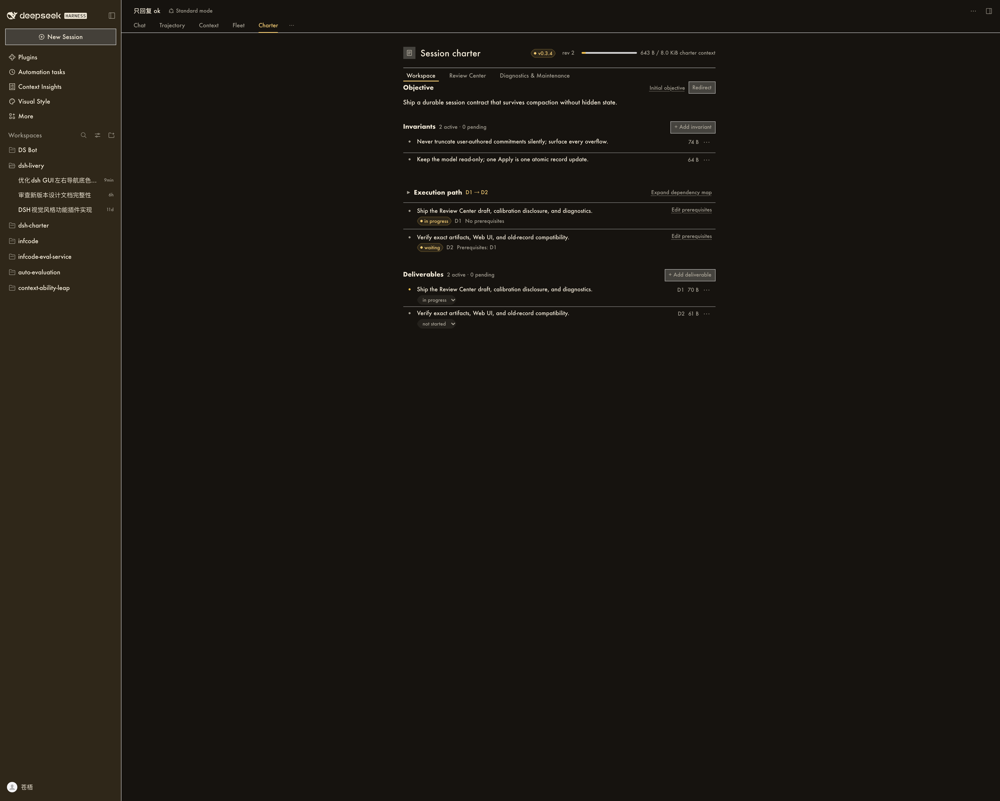
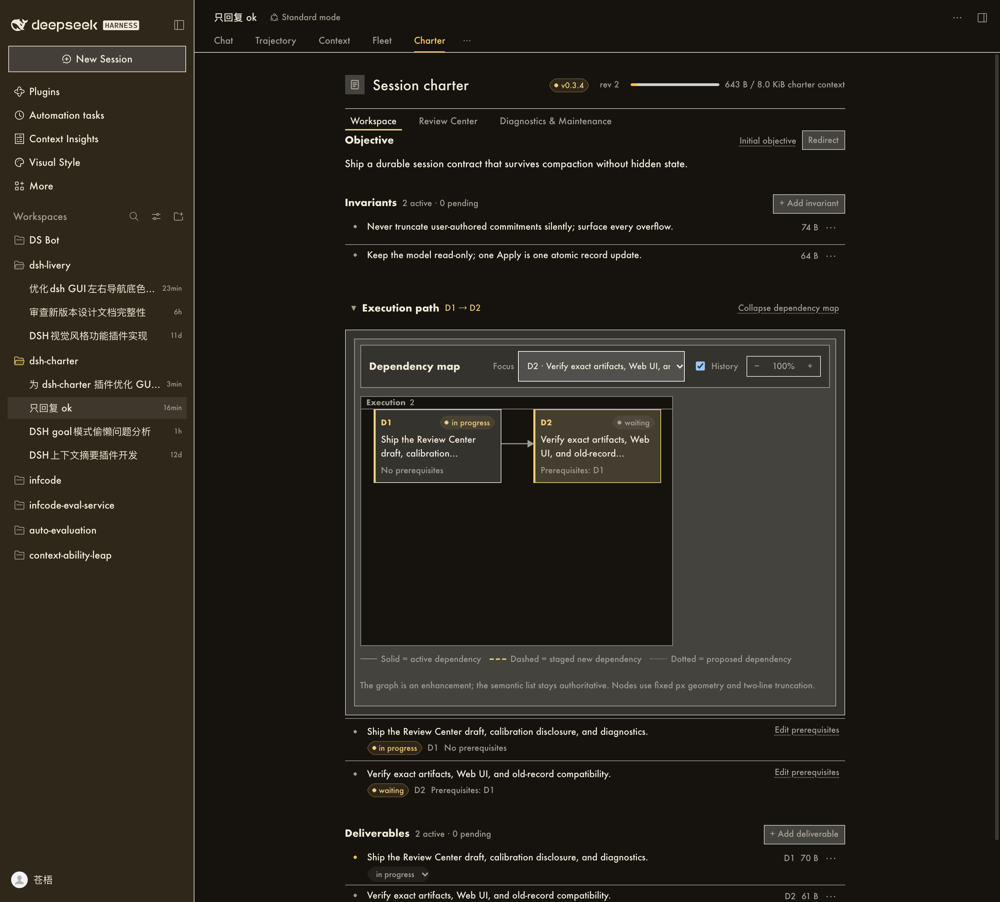

# dsh-charter

[](LICENSE)
[](https://github.com/centella-cream/dsh-charter)
[](docs/design/compatibility.md)
[](package.json)
[](#status)

English | [中文](README.zh.md)

> **Compaction rewrites history. Your commitments don't.**

`dsh-charter` is a durable, user-owned session contract for [DeepSeek Harness](https://github.com/deepseek-ai/deepseek-harness). Goals, hard constraints, deliverables, evidence, and dependency relationships survive compaction and remain visible and editable.





The Pane keeps the workspace, Review Center, and Diagnostics in one document column. Screenshots crop to the right-hand Pane, follow the current system theme, and use synthetic demo data whose UI and contract text match the README language; the Chinese images reuse the three Chinese deliverables from the `0.3.3` demo session.

## Status

- **Current published release:** `0.3.3` — structured draft extraction, automatic zh/en language following, duplicate folding, stable draft refs, deferred non-blocking translation, and adaptive batch translation.
- **Development candidate:** `0.3.4` — opt-in, consent-gated draft calibration: semantic aggregation, readable rewriting, original-vs-calibrated review, `c-*` apply provenance, and real-model calibration status/diagnostics.
- **Previous release:** `0.3.2` — accessibility/evidence convergence; `0.3.1` and `0.3.0` are earlier baselines.
- **Primary DSH baseline:** `0.2.2-rc.5`; 13 declared DSH versions are source-matrix verified.
- From `0.3.4`, the **Plugins** page shows a localized title and versioned description, including the calibration data-use limitation.

## Core capabilities

- **Durable, user-owned authority.** One `dsh-storage-domain` record per Session is the source of truth; the model has no write capability. Apply is one atomic edit.
- **Document-feel Pane.** Underline area tabs, aligned rows, byte counters, a prompt meter, and a quiet visual language across Workspace, Review Center, and Diagnostics.
- **Structured draft review.** Compaction summaries become review-only candidates: sentence-boundary splitting, oversized/truncated markers, duplicate folding, stable `d-*` refs, and review-only Apply.
- **Optional smart calibration.** An opt-in, consent-gated Host model call can aggregate/rewrite draft candidates (`c-*`), with uncertain/merged/split provenance, original excerpts, and “use original”. It is disabled by default.
- **Language following.** The source draft renders immediately; when needed, bounded batch translation follows in the background. A dedicated translation model can be configured.
- **Dependency graph.** A local, ego-scoped graph and semantic list share the same Change Set; the graph is an enhancement, not a second authority.
- **Bounded by design.** Context/item/record/operation budgets are visible; overflow becomes pending proposals or a visible refusal, never silent truncation.

## Install

The latest published release is `0.3.3`:

```bash
dsh plugin --profile web add dsh-charter@0.3.3
# offline / exact artifact:
npm pack dsh-charter@0.3.3
dsh plugin --profile web add ./dsh-charter-0.3.3.tgz
```

`0.3.4` is the current development candidate:

```bash
npm pack
dsh plugin --profile web add ./dsh-charter-0.3.4.tgz
```

Desktop uses **Plugins → Install/Update** (local tarball if your build supports it). Pin exact versions for reproducible profiles; do not bypass the compatibility gate to force an older release.

### Update and rollback

Update with the exact version or local tarball. The client bundle can hot-swap through the profile; if the new Host service or Remote methods are not live after the install result, reload the Host or Desktop once. A full quit is a fallback, not a requirement for a client-only change. To roll back, install the previous exact version (`0.3.3` is the current published release); records written by `0.3.2`/`0.3.3`/`0.3.4` remain readable without migration.

### Requirements

- DSH versions listed in the [compatibility matrix](docs/design/compatibility.md); primary baseline `0.2.2-rc.5`.
- Node.js `^22.19.0 || >=24.0.0`.
- Web or Desktop profile. `0.2.1+` is required for per-Peer Remote authorization.

## Quick start

1. Open a Session in DSH and switch to **Charter**.
2. Add an objective, invariants, and deliverables in the Workspace, or review a compaction draft in the Review Center.
3. Review the Change Set, then Apply atomically.
4. For a compacted Session, the review draft appears from the latest usable compaction summary. Accept/apply only what you intend to keep.

## Configuration

Defaults live in `cordis.patch.yml`; override the same keys in the profile config. The most useful settings:

```yaml
- id: charter
  config:
    maxPromptBytes: 8192
    maxObjectiveBytes: 4096
    maxItemBytes: 1024
    contextOrder: 130
    languageFollow: true
    languageFollowTimeoutMs: 60000
    # optional dedicated translation route:
    # languageFollowProvider: your-provider
    # languageFollowModel: your-fast-model
    calibration:
      enabled: false
      consentVersion: 0
      maxCandidates: 12
      maxOutputTokens: 2048
```

| Field | Default | Meaning |
| --- | ---: | --- |
| `maxPromptBytes` | 8192 | UTF-8 budget for the charter contribution |
| `maxObjectiveBytes` | 4096 | objective byte budget |
| `maxItemBytes` | 1024 | per-item text budget |
| `maxItems` / `maxPendingItems` | 512 / 512 | item and pending-proposal limits |
| `maxOps` / `maxRecordBytes` | 1024 / 1048576 | per-Apply operations and record budget |
| `contextOrder` | 130 | runtime-context order |
| `languageFollow` | true | follow the active `zh`/`en` DSH locale |
| `languageFollowTimeoutMs` | 60000 | background translation batch timeout |
| `languageFollowProvider` / `.model` | unset | optional dedicated translation route |
| `calibration.enabled` | false | opt-in smart draft calibration |
| `calibration.consentVersion` | 0 | accepted disclosure version; set to `1` after reading the disclosure |
| `calibration.provider` / `.model` | unset | optional dedicated calibration route |
| `calibration.maxCandidates` | 12 | calibrated candidate cap |
| `calibration.maxOutputTokens` | 2048 | calibration output-token cap |

Calibration sends compaction draft text and current charter items to the configured provider/model; model usage is charged, including reasoning tokens. Results are pending proposals only and never enter the standing prompt before you accept them. The cache is memory-only. Never enable calibration without reading the disclosure in Review Center.

## Compatibility

| DSH version | Status |
| --- | --- |
| `0.1.7-rc.2` | Supported (minimum) |
| `0.2.0-rc.1` / `0.2.0-rc.2` | Supported |
| `0.2.1-rc.1` … `0.2.1-rc.5` | Supported |
| `0.2.2-rc.1` … `0.2.2-rc.5` | Supported (primary baseline: `0.2.2-rc.5`) |
| `0.2.3-alpha.x` | Not supported |
| `0.3.x` | Not declared until verified |

`engines.dsh` is bounded to the 0.2 line; the exact `dshReleases`/peer list is the matrix-verified support set. See [compatibility](docs/design/compatibility.md).

## Security and privacy

- User text stays user-role; the model never receives a write capability.
- Calibration and language normalization are opt-in model calls; no telemetry or upload path is added by the plugin, and credentials stay in DSH.
- Automatic language following is disclosed and uses the configured session/dedicated model. Set `languageFollow: false` to avoid that call.
- Records are stored in the Session’s `dsh_charter_v1` domain; export/restore are owner-only maintenance operations.
- Report security issues privately as described in [SECURITY.md](SECURITY.md).

## Development

```bash
npm ci
npm run check                    # typecheck + build + smokes + Vitest + token gate
npm run verify:ui-metrics -- --gate=final
npm run smoke:package
node scripts/verify/recovery-smoke.mjs --artifact dist/dsh-charter-<version>.tgz --sha256 SHA256SUMS
node scripts/verify/compat-matrix.mjs --versions all
```

See [CONTRIBUTING.md](CONTRIBUTING.md), the [verification record](docs/verification.md), and [release process](docs/releasing.md). Public CI runs `npm run check` and `npm run smoke:package` on Node 22.19.0 and 24; exact-artifact, compatibility, and browser/Desktop gates are separate.

## Documentation

- [User guide](docs/user-guide.md)
- [Design authority and roadmap](docs/design/version-roadmap.md)
- [Structured extraction design](docs/design/charter-draft-extraction-v1.zh.md)
- [Draft calibration design](docs/design/charter-draft-calibration-v1.zh.md)
- [Compatibility matrix](docs/design/compatibility.md)
- [Documentation index](docs/README.md)

## License

MIT. See [LICENSE](LICENSE).
