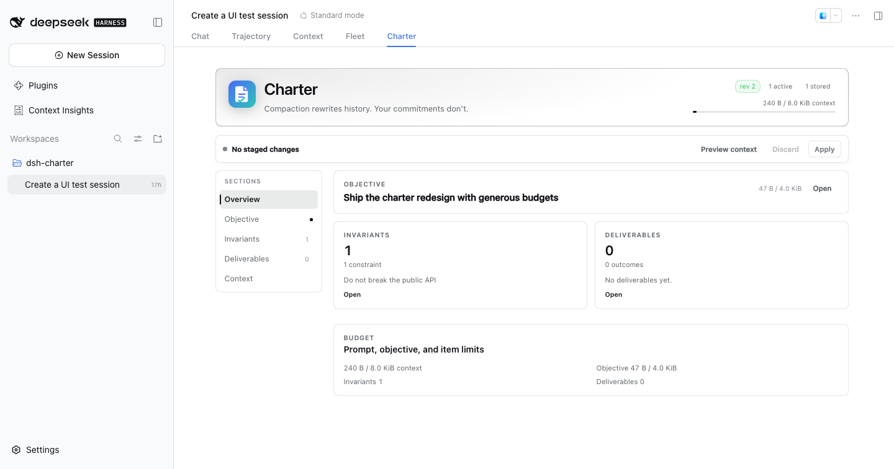
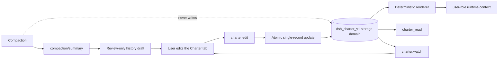

# dsh-charter

[](LICENSE)
[](https://github.com/centella-cream/dsh-charter)
[](docs/design/compatibility.md)
[](package.json)
[](#status)

English | [中文](README.zh.md)

> **Compaction rewrites history. Your commitments don't.**

`dsh-charter` is a durable, user-owned task contract for
[DeepSeek Harness](https://github.com/deepseek-ai/deepseek-harness). Goals, hard constraints, and
deliverables stay visible across context compaction — and remain editable at any time.



Dark theme and narrow-layout evidence: [dark](docs/assets/charter-pane.dark.png), [narrow](docs/assets/charter-pane.narrow.png).

> A real English Web profile with `dsh-context` installed. The tab order is Chat, Trajectory, Context, Fleet,
> then Charter; every pane string follows the active DSH language.

## Contents

- [Why](#why)
- [Highlights](#highlights)
- [How it works](#how-it-works)
- [Install](#install)
- [Quick start](#quick-start)
- [The Charter tab](#the-charter-tab)
- [Configuration](#configuration)
- [Compatibility](#compatibility)
- [Security and privacy](#security-and-privacy)
- [Development](#development)
- [Documentation](#documentation)
- [Acknowledgements](#acknowledgements)
- [Contributing](#contributing)
- [License](#license)

## Why

Compaction replaces older history with a summary. A summary can keep the general task while quietly dropping
standing constraints such as *“do not touch migrations/”*, *“run tests before delivery”*, or *“keep the API
backward compatible”*. Promoting those constraints to the system prompt would instead cross the user-content
permission boundary.

`dsh-charter` solves a narrow problem well:

- **Independent authority.** One `dsh-storage-domain` record per Session is the only authoritative source.
  Compaction summaries and UI caches are never writers or recovery sources.
- **User role by construction.** Editable user text enters `systemPrompt.context()`, never a system-role
  message. The model can read the charter through `charter_read`; it cannot write it.
- **Deterministic rebuild.** The same record revision and renderer version produce byte-identical context.
  `{{...}}` runs are escaped so older DSH prompt interpolators cannot rewrite user text.
- **Explicit budgets.** The tab shows a live context meter and per-field byte counters. Overflow is rejected
  or surfaced for selection — never silently truncated.
- **Atomic Apply.** One edit commits completely or not at all, with revision conflicts and idempotent retries.
- **Safe onboarding.** An existing compacted Session gets a review-only history draft from its latest compaction
  summary; nothing becomes effective until you review and apply it.
- **Drafts survive navigation.** Staged edits, an open inline editor, and a reviewed history draft belong to the
  Session, not to the mounted tab, so checking the conversation and coming back does not lose work.
- **Fail closed and degrade per Session.** One stored record that loads but fails the strict inner schema or
  consistency checks disables only that Session (its raw bytes are preserved for diagnosis); a charter that
  exceeds a later-tightened budget is shown as over-budget instead of corrupt, is not injected, and can be shrunk
  back into range. An **unreadable outer JSON record** is a documented residual risk: the JSON storage backend
  treats it as absent and the plugin cannot distinguish it from a missing record (verification §4.5).
- **Recoverable applies.** A retry reuses the mutation id of an unknown-outcome request, and a revision
  conflict offers an explicit apply-to-latest action instead of discarding the draft.

A charter is a declaration, not an enforcement policy. Use Host permissions, sandbox policy, hooks, or
execution guards for restrictions that must be machine-enforced.

## Highlights

- Separate original and current objective; ordinary edits never rewrite the original.
- `invariant` and `deliverable` items with orthogonal review, lifecycle, verification, and progress state.
- A localised conversation-view tab registered once at a stable high order (1000), so it follows Chat, Trajectory,
  and common plugin tabs without re-registering itself.
- A compact, navigable pane: **Overview / Objective / Invariants / Deliverables / History / Context**.
- Sticky Preview / Discard / Apply toolbar and an exact preview of the model-visible user-role context.
- History draft extraction from `compaction/summary`; deterministic, no model call, no automatic write.
- English/Chinese UI, light/dark themes, keyboard focus states, and container-query responsiveness.
- Read-only `charter_read` tool with a compact standing projection; one-time fork copy; explicit degraded
  states across restart, compaction, unload, corrupted records, and over-budget configurations.

## How it works



The Host service initializes a record on `session/created` and before the first prompt on `agent/created`.
The browser registers a `conversation.view` entry; the pane and `charter.watch` use the same revisioned view.
`charter.bootstrap` reads the latest usable compaction summary and returns a draft only — it does not write storage.

## Install

`dsh-charter@0.1.0-rc.2` is the current npm pre-release. Our channel policy is to publish it under `next` and to
point `latest` at the newest RC until a stable release exists (npm keeps a `latest` tag and we choose where it
points; this is our policy, not an npm requirement). Pin the exact version for reproducible profiles, and use
`@next` to track the newest pre-release.

### Requirements

- DSH: only the versions listed in the [compatibility matrix](docs/design/compatibility.md) are supported
  (`0.1.7-rc.2`, `0.2.0-rc.1`/`rc.2`, `0.2.1-rc.1`/`rc.2`). Newer stable/RC versions are not claimed until the
  matrix is extended; `0.2.1+` is required for per-Peer Remote resource authorization.
- Node.js **`^22.19.0 || >=24.0.0`**.
- A Web or Desktop profile.

### Install from npm (recommended)

#### Web profile — install by version or pre-release tag

```bash
dsh plugin --profile web add dsh-charter@0.1.0-rc.2   # exact version: reproducible
dsh plugin --profile web add dsh-charter@next         # newest pre-release
```

Use the exact version for reproducible profiles, or `@next` to track the newest pre-release. Under the current
channel policy `@latest` points at the newest RC until a stable release exists. If the registry is unreachable,
use the offline tarball fallback below.

Restart `dsh web` (or let profile HMR recompose), then refresh the page. The profile's `package.json` gains the
dependency and bundle entry.

#### Desktop — install from Plugins

If your Desktop build exposes the public plugin catalog, open **Desktop → Plugins**, search for
**`dsh-charter`**, and click **Install** (or **Update** when already installed). Desktop owns the plugin
lifecycle and hot-applies the new bundle. Otherwise use the offline tarball fallback below.

### Offline / local tarball fallback

Use this path for air-gapped machines, Desktop builds that only import local plugins, or verifying the exact
release artifact. The GitHub Release ships the same tarball and `SHA256SUMS` used by `npm publish`.

```bash
# From a checkout:
npm install
npm run build
npm pack                         # dsh-charter-0.1.0-rc.2.tgz
dsh plugin --profile web add ./dsh-charter-0.1.0-rc.2.tgz

# Or download the GitHub Release tarball + SHA256SUMS and verify:
shasum -a 256 -c SHA256SUMS
dsh plugin --profile web add ./dsh-charter-0.1.0-rc.2.tgz
```

`dsh plugin --profile desktop` is intentionally refused by the Electron app that owns that profile; use the
Desktop Plugins page or that profile's package manager. Source-level development is described in
[CONTRIBUTING.md](CONTRIBUTING.md); do not use `git clone` as the normal installation method.

### Update

- **Web (npm):** `dsh plugin --profile web add dsh-charter@next`, then restart/refresh. Pinned profiles keep
  their explicit `0.1.0-rc.2` entry.
- **Local tarball:** rebuild/download the new tarball and repeat the local install command.
- **Desktop:** Plugins → `dsh-charter` → **Update**; Desktop hot-applies it.

## Quick start

### Bring an existing compacted Session

1. Open an old Session that has already been compacted **and is live in this Web process**.
2. Open the **Charter** tab. If its charter is empty, the plugin reads the latest `compaction/summary` and shows a
   **History draft** tab.
3. Review or edit the candidates, uncheck anything stale, and click **Apply draft**. Only then does the content
   become effective and enter the next model request.

History extraction is deterministic and heuristic: it selects high-signal sections and splits long candidates
instead of truncating them. The review step is intentionally mandatory.

### Start a new charter

1. Open **Charter** in a started Session.
2. Set the objective.
3. Add invariants and deliverables in their sections.
4. Use **Preview context** to inspect the exact user-role text and byte count.
5. Click **Apply**. A revision conflict preserves your draft and shows the server revision.

## The Charter tab

The tab is opened from the conversation header; it is registered once at a stable high order (1000), so it follows
Chat, Trajectory, and common plugin tabs without re-registering itself. The pane
has a left section navigation on wide screens and a horizontal tab strip on narrow screens:

| Section | Purpose |
| --- | --- |
| **Overview** | Objective summary, invariant/deliverable cards, budget, history-draft callout |
| **Objective** | Edit or redirect the objective; the original is immutable |
| **Invariants** | Add, edit, replace, archive, purge, and verify hard constraints |
| **Deliverables** | Same actions plus delivery progress |
| **History** | Always available: apply a draft extracted from the latest usable compaction summary, or inspect the current bootstrap phase and re-check |
| **Context** | Exact user-role runtime context, bytes, and limits |

While the Charter view is active it owns the whole reading surface: the chat composer is hidden, and its
draft returns untouched when you switch back to **Chat**. Approval/question/plan-review seats stay visible.

When a history draft has more candidates than the context budget can hold, the extra candidates are imported as
**pending proposals** in the same atomic Apply. They remain visible and reviewable; nothing is rejected because
of an arbitrary per-kind active-count cap.

Budgets are visible everywhere. Long draft items become multiple candidates; over-limit fields are highlighted.
The charter-context budget is the gate: when a history draft does not fit, the remaining candidates become pending
proposals instead of blocking the whole import. Apply is disabled only for real field, storage, or atomic limits.

## Configuration

Defaults live in `cordis.patch.yml`. Override them in the profile patch:

```yaml
- id: charter
  config:
    maxPromptBytes: 8192
    maxObjectiveBytes: 4096
    maxItemBytes: 1024
    contextOrder: 130
```

| Field | Default | Meaning |
| --- | ---: | --- |
| `maxPromptBytes` | 8192 | UTF-8 budget for the charter contribution only (excludes history, system, tools, and other contexts) |
| `maxObjectiveBytes` | 4096 | UTF-8 budget for the objective |
| `maxItemBytes` | 1024 | per-item text budget |
| `maxItems` | 512 | all-items storage limit |
| `maxPendingItems` | 512 | pending-proposal limit |
| `maxOps` | 1024 | operations per Apply |
| `maxRecordBytes` | 1048576 | one Session record |
| `historyLimit` | 64 | recent history receipts |
| `maxHistoryBytes` | 131072 | recent history bytes |
| `mutationLimit` | 128 | recent mutation receipts |
| `contextOrder` | 130 | runtime-context order; after sandbox/approval/subagent by default |

The only model-visible capacity is `maxPromptBytes`; active invariants and deliverables are not capped
separately. `maxItems` and `maxPendingItems` bound storage. When a history draft does not fit the context
budget, the candidates that fit are imported as active and the rest become pending proposals — not rejected,
truncated, or silently dropped.

## Compatibility

| DSH version | Status |
| --- | --- |
| `0.1.7-rc.2` | Supported (minimum) |
| `0.2.0-rc.1` / `0.2.0-rc.2` | Supported |
| `0.2.1-rc.1` / `0.2.1-rc.2` | Supported (primary baseline) |
| `0.1.5-rc.1` and earlier | Not supported |
| `0.2.2-rc.x`, `0.3.x` | Not declared until verified |

"Supported" means typecheck, build, tests, and Remote/client smoke for that version. Interactive Web UI was
exercised on `0.2.0-rc.2`; other versions are API/build verified. Real-model compaction end-to-end is a documented manual check (`npm run verify:compaction`, section 8 of the verification record); a **PASS is recorded there (§8.4, 2026-10-22)**.
The full matrix and degradation notes are in the [compatibility document](docs/design/compatibility.md).
`0.1.7`/`0.2.0` have no per-Peer Remote resource authorization; use them only in a trusted single-operator
environment.

## Security and privacy

- User-authored text never enters a system-role message.
- The model has no charter write capability; `charter_read` is read-only. Its `standing` view returns the complete
  current working set (bounded by record quotas) in a compact form that omits debug-only ids/review/lifecycle, so
  metadata cannot inflate the tool result; there is no fixed byte cap on `standing`, so a maximum-size charter can
  produce a large tool result. The `all` debug page is capped at 64 items / 32 KiB (final envelope) and reports
  omitted items; paging `standing` is a documented follow-up.
- Actor policy: `owner` may perform all edits including purge; `user` may perform ordinary edits but not purge;
  `host` is rejected on the Remote edit path. Records are bound to `createdAt`, `cwd`, and `parentSession`;
  reusing a Session id across lifecycles is rejected.
- Ordinary logs contain stable ids, kinds, revisions, and error codes — not user body text.
- A charter is not a permission system. See [SECURITY.md](SECURITY.md) for the threat model and reporting path.

## Development

```bash
npm run typecheck        # strict TS
npm test                 # build + Vitest
npm run build            # Host ESM + single-file browser bundle + smoke
npm run check            # typecheck + build + tests
npm run smoke:package    # packed tarball installability
npm run verify:compaction # manual real-model compaction check (not part of check)
```

The test suite covers the pure core, real Host composition, storage-domain behavior, Remote framing,
history extraction, client state, and factory-bundle registration. Current matrix: **263 tests on DSH `0.1.7-rc.2`, `0.2.0-rc.1`/`rc.2`, and `0.2.1-rc.1`/`rc.2`**. See the [verification record](docs/verification.md) for commands and evidence.

## Acknowledgements

The design research for this project benefited from two independent community projects:

- [dsh-context-enhancement](https://github.com/chuxindd/dsh-context-enhancement) — per-record storage,
  Session lifecycle fencing, durable publish ordering, and revision conflict handling.
- [dsh-ontology](https://www.npmjs.com/package/dsh-ontology) — a pure domain kernel, stable error codes, and
  overlay validation before writes.

Their ideas informed the design review; no source code is copied, and these projects do not endorse
`dsh-charter`. See the [research notes](docs/research/charter-research.md) for the detailed comparison.

## Documentation

- [Design specification](docs/design/charter-design.md)
- [Design review](docs/design/charter-design-review.md)
- [Compatibility matrix](docs/design/compatibility.md)
- [User and operator guide](docs/user-guide.md)
- [Verification record](docs/verification.md)
- [Research notes](docs/research/charter-research.md)
- [Release checklist](docs/releasing.md)

Every long-form document has an English and Chinese version, linked at the top of each page.

## Contributing

Issues and pull requests are welcome. Please read [CONTRIBUTING.md](CONTRIBUTING.md) and the
[Code of Conduct](CODE_OF_CONDUCT.md) before changing the Host contract, prompt boundary, or client bundle. For
security reports, follow [SECURITY.md](SECURITY.md).

## Status

Pre-1.0. The DSH plugin ABI is still moving; compatibility is tested against the versions above, and the design
keeps the compatibility layer deliberately small. The public repository is [centella-cream/dsh-charter](https://github.com/centella-cream/dsh-charter). This tree is the `0.1.0-rc.2` pre-release: the real-model
compaction acceptance **PASS is recorded on 2026-10-22** on an anonymized evaluation Session (326 messages /
~228k tokens shadowed, revision-1 charter survived with matching digest — see verification §8.4). The rc.2 candidate
is verified locally and is intended for the npm registry under the `next` dist-tag; under our channel policy
`latest` also tracks the newest RC until a stable release exists (a deliberate policy choice, not an npm
requirement). One manual check recorded in §8.4 is required before a stable `latest` release: restart the Desktop
app and reopen the Charter tab once to confirm the installed bundle/tool ABI. CI
(`.github/workflows/ci.yml`) packs and smoke-tests the installable artifact on Node `22.19.0` and `24`; the local
gate evidence is recorded in verification §2. Release-state prerequisites, tag ordering, and the exact publish
flow live in [docs/releasing.md](docs/releasing.md).

## License

[MIT](LICENSE) © 2026 dsh-charter contributors.
