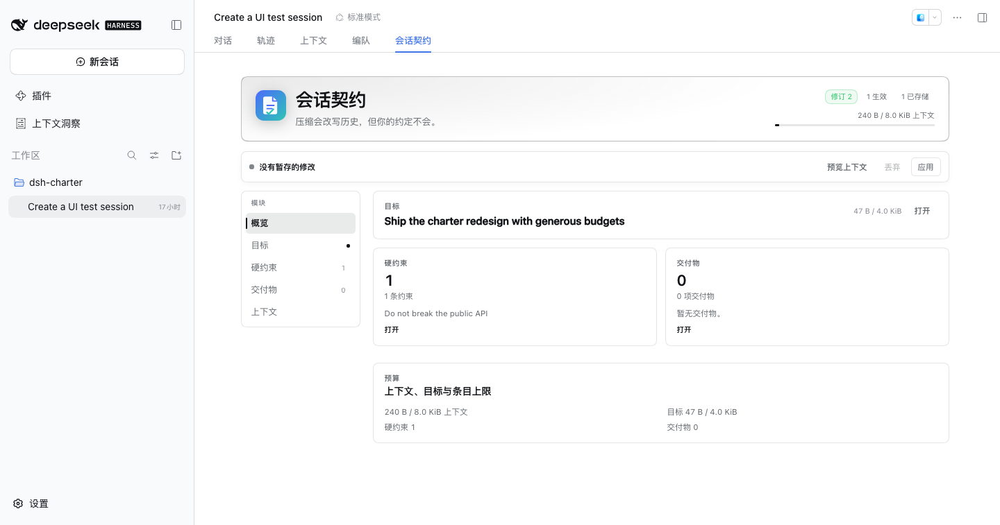
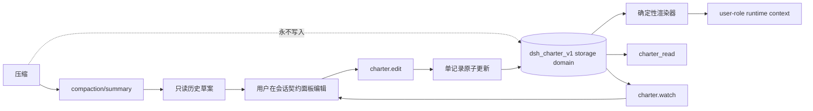

# dsh-charter

[](LICENSE)
[](https://github.com/centella-cream/dsh-charter)
[](docs/design/compatibility.zh.md)
[](package.json)
[](#状态)

[English](README.md) | 中文

> **压缩会改写历史，但你的约定不会。**

`dsh-charter` 为 [DeepSeek Harness](https://github.com/deepseek-ai/deepseek-harness) 提供持久、用户所有的
「会话契约」：目标、硬约束和交付物在上下文压缩后仍然可见，并且随时可编辑。



暗色与窄屏证据：[暗色](docs/assets/charter-pane.dark.png)、[窄屏](docs/assets/charter-pane.narrow.png)。

> 真实中文 Web profile，同时安装 `dsh-context`。标签顺序为「对话」「轨迹」「上下文」「编队」「会话契约」；
> 面板全部文案跟随 DSH 当前语言。

## 目录

- [为什么需要](#为什么需要)
- [亮点](#亮点)
- [工作原理](#工作原理)
- [安装](#安装)
- [快速开始](#快速开始)
- [会话契约标签页](#会话契约标签页)
- [配置](#配置)
- [兼容性](#兼容性)
- [安全与隐私](#安全与隐私)
- [开发](#开发)
- [文档](#文档)
- [致谢](#致谢)
- [贡献](#贡献)
- [许可证](#许可证)

## 为什么需要

压缩会用摘要替换较早的历史。摘要可能保留总体任务，却悄悄丢掉持续约束，例如「不要修改 migrations/」、
「交付前跑测试」、「保持公共 API 向后兼容」。把这些内容放进 system prompt，又会越过用户内容的权限边界。

`dsh-charter` 只解决一个窄问题，但把它解决好：

- **独立正本**：每个 Session 一条 `dsh-storage-domain` 记录，压缩摘要和 UI 缓存永远不是写入者或恢复源。
- **保持 user role**：可编辑的用户正文通过 `systemPrompt.context()` 注入，绝不进入 system-role 消息。
  模型可以经 `charter_read` 读取，但不能写入。
- **确定性重建**：相同 revision 和渲染器版本产生逐字节一致的上下文；`{{...}}` 片段会被转义，旧版 DSH
  的 prompt 插值器无法改写用户文本。
- **显式预算**：面板显示实时上下文预算和每个字段的字节计数；超限会被拒绝或交给用户选择，绝不静默截断。
- **原子 Apply**：一次编辑要么全部提交，要么完全不提交；支持 revision 冲突与幂等重试。
- **安全的上手**：已有压缩历史的 Session 会得到一份只读的「历史草案」；用户审阅并应用前不生效。
- **草稿不随页面切换丢失**：暂存修改、打开中的行内编辑器和已审阅的历史草案都属于 Session 而不是当前挂载
  的标签页；切到对话再回来不会丢失。
- **逐 Session 降级与 fail closed**：单条**可加载但违反严格内部 schema/一致性检查**的存储记录只禁用该 Session
  （原始字节保留以便诊断）；后来收紧预算的会话契约显示为 **超预算（over-budget）** 状态而不是损坏，不被注入，
  并可通过删除/归档收敛回预算内。**外层 JSON 不可读**是已记录的残留风险：JSON storage backend 会把它当作记录
  不存在，插件无法与"记录缺失"区分（见验证记录 4.5）。
- **可恢复的应用**：结果未知的请求重试时复用同一 mutation id；revision 冲突提供“应用到最新修订”，而不是
  直接丢弃草稿。

会话契约是**声明**，不是执行策略。需要机器强制的限制请使用 Host 权限、sandbox、hook 或工具守卫。

## 亮点

- 原始目标与当前目标分离；普通编辑永远不会改写原始目标。
- `invariant` 与 `deliverable` 条目，review / lifecycle / verification / progress 四个维度正交。
- 会话头部标签页，以稳定的高 order（1000）注册一次，因此排在「对话」「轨迹」和常见插件标签之后，不会重新注册。
- 可在 **概览 / 目标 / 硬约束 / 交付物 / 历史草案 / 上下文** 间导航的紧凑面板。
- 吸顶的预览/丢弃/应用工具栏，以及模型实际收到的 user-role 上下文精确预览。
- 从 `compaction/summary` 确定性生成历史草案；不调用模型，不自动写入。
- 中英文界面、明暗主题、键盘焦点和容器查询响应式布局。
- 只读 `charter_read` 工具（紧凑 standing 投影）；fork 一次性复制；重启、压缩、卸载、记录损坏和预算收紧时
  都有明确降级状态。

## 工作原理



Host 在 `session/created` 时初始化记录，并在首次 prompt 前的 `agent/created` 等待初始化完成。浏览器注册
`conversation.view` 标签页；面板和 `charter.watch` 使用同一份 revisioned view。`charter.bootstrap` 只读取
最近一次可用压缩摘要（若最新摘要无法产出候选，则回退到更早的可用摘要）并返回草案，不写入 storage。

## 安装

`dsh-charter@0.1.0-rc.2` 是当前 npm 预发布版本。当前渠道策略是发布到 `next`，并在稳定版出现前让 `latest` 也指向
最新 RC（npm 会保留 `latest` tag，由我们决定其指向；这是我们的策略，不是 npm 的强制要求）。需要可复现 profile
时固定精确版本。
npm 目前也会把这个首个 RC 暴露在 `latest` 下，因为 npm 会给新包的首次发布自动设置 `latest`——稳定版发布后
会替换它。不要依赖 `@latest` 安装预发布版。

### 环境要求

- DSH：只支持[兼容矩阵](docs/design/compatibility.zh.md)中列出的版本（`0.1.7-rc.2`、`0.2.0-rc.1`/`rc.2`、
  `0.2.1-rc.1`/`rc.2`）。在扩展矩阵前不声明支持更新的 stable/RC 版本；per-Peer Remote 资源授权需要 `0.2.1+`。
- Node.js **`^22.19.0 || >=24.0.0`**。
- Web 或 Desktop profile。

### 从 npm 安装（推荐）

#### Web profile — 按版本或预发布 tag 安装

```bash
dsh plugin --profile web add dsh-charter@0.1.0-rc.2   # 精确版本：可复现
dsh plugin --profile web add dsh-charter@next         # 最新预发布
```

固定精确版本可以保证 profile 可复现；`@next` 跟踪最新预发布。`@latest` 不是预发布渠道，稳定版出现后会指向
稳定版。registry 不可达时，使用下面的离线 tarball 回退方式。

重启 `dsh web`（或等待 profile HMR 重新组合），然后刷新页面。profile 的 `package.json` 会增加依赖和
bundle 选择。

#### Desktop — 从 Plugins 安装

如果你的 Desktop 版本已接入公开插件目录，打开 **Desktop → Plugins**，搜索 **`dsh-charter`**，点击
**Install**；已安装时点击 **Update**。Desktop 管理插件生命周期并热更新新的 bundle。否则使用下面的离线
tarball 回退方式。

### 离线 / 本地 tarball 回退

适用于离线/air-gapped 机器、只能导入本地插件的 Desktop 构建，或需要校验精确发布产物的场景。GitHub Release
附带与 `npm publish` 完全相同的 tarball 和 `SHA256SUMS`。

```bash
# 在 checkout 中：
npm install
npm run build
npm pack                         # dsh-charter-0.1.0-rc.2.tgz
dsh plugin --profile web add ./dsh-charter-0.1.0-rc.2.tgz

# 或下载 GitHub Release 的 tarball + SHA256SUMS 并校验：
shasum -a 256 -c SHA256SUMS
dsh plugin --profile web add ./dsh-charter-0.1.0-rc.2.tgz
```

`dsh plugin --profile desktop` 会被拥有该 profile 的 Electron app 拒绝；请使用 Desktop 的 Plugins 页面或该
profile 自己的包管理器。源码开发流程见 [CONTRIBUTING.zh.md](CONTRIBUTING.zh.md)；不要把 `git clone` 当作普通
用户的安装方式。

### 更新

- **Web（npm）**：`dsh plugin --profile web add dsh-charter@next`，然后重启/刷新；固定版本 profile 继续使用
  显式的 `0.1.0-rc.2`；
- **本地 tarball**：重新构建/下载新 tarball，并重复本地安装命令；
- **Desktop**：Plugins → `dsh-charter` → **Update**，Desktop 会热更新。

## 快速开始

### 已有压缩历史的会话

1. 打开一个**已经触发过压缩、且当前 Web 进程里是 live** 的旧会话。
2. 打开「会话契约」。如果会话契约为空，插件会读取最近一次 `compaction/summary`，出现「历史草案」标签。
3. 检查/编辑候选内容，取消不合适的勾选，点击 **应用草案**。只有这时内容才生效并进入下一次模型请求。

历史抽取是确定性启发式：选择高信号章节，并把长候选拆成多条而不是截断。人工审阅是强制的。

### 新会话

1. 在已开始的会话中打开「会话契约」。
2. 设置目标。
3. 在对应 section 添加硬约束和交付物。
4. 用 **预览上下文** 查看精确的 user-role 文本和字节数。
5. 点击 **应用**。若 revision 冲突，草稿会保留并显示服务端最新 revision。

## 会话契约标签页

标签页从会话头部打开，以稳定的高 order（1000）注册一次，因此排在「对话」「轨迹」和常见插件标签之后。宽屏使用
左侧 section 导航，窄屏使用横向 tab：

| Section | 用途 |
| --- | --- |
| **概览** | 目标摘要、硬约束/交付物卡片、预算、历史草案入口 |
| **目标** | 编辑或调整目标；原始目标不可改写 |
| **硬约束** | 添加、编辑、替换、归档、清除、验证 |
| **交付物** | 同样的操作，外加交付进度 |
| **历史草案** | 始终可见：应用从最近一次可用压缩摘要抽取的草案，或查看当前 bootstrap 阶段并重新检查 |
| **上下文** | 精确的 user-role runtime context、字节数和限额 |

「会话契约」激活时独占整个阅读区域：对话框会被隐藏，切回「对话」时草稿原样恢复。审批/提问/计划审阅
等必须保留的输入位不会被隐藏。

历史草案候选多于上下文预算时，多出的候选会在同一次原子 Apply 中保存为**待审提案**，仍然可见、可审阅；
不会因为任意 per-kind active 条数上限而拒绝整个草案。

预算在界面各处可见。超长草案条目会拆成多个候选，超限字段高亮。契约上下文预算是门槛：历史草案放不下时，
剩余候选保存为待审提案，而不是阻塞整个导入。只有真实的字段、存储或单批限制才会禁用 Apply。

## 配置

默认值写在 `cordis.patch.yml`，可在 profile patch 中覆盖：

```yaml
- id: charter
  config:
    maxPromptBytes: 8192
    maxObjectiveBytes: 4096
    maxItemBytes: 1024
    contextOrder: 130
```

| 字段 | 默认 | 说明 |
| --- | ---: | --- |
| `maxPromptBytes` | 8192 | 仅会话契约 contribution 的 UTF-8 预算（不含历史消息、system、tools 和其他 context） |
| `maxObjectiveBytes` | 4096 | 目标文本的 UTF-8 上限 |
| `maxItemBytes` | 1024 | 单条条目文本上限 |
| `maxItems` | 512 | 全部条目存储上限 |
| `maxPendingItems` | 512 | pending 提议上限 |
| `maxOps` | 1024 | 单次 Apply 的 op 数 |
| `maxRecordBytes` | 1048576 | 单条 Session record 上限 |
| `historyLimit` | 64 | 近期 history 条数 |
| `maxHistoryBytes` | 131072 | 近期 history 字节上限 |
| `mutationLimit` | 128 | 近期 mutation 回执上限 |
| `contextOrder` | 130 | runtime context 排序；默认在 sandbox/approval/subagent 之后 |

模型可见容量只有 `maxPromptBytes`；active invariant/deliverable 不再单独设条数上限。`maxItems` 和
`maxPendingItems` 约束存储。历史草案放不进上下文预算时，能放下的候选会直接生效，其余保存为待审提案，
不会被拒绝、截断或静默丢弃。

## 兼容性

| DSH 版本 | 状态 |
| --- | --- |
| `0.1.7-rc.2` | 支持（最低版本） |
| `0.2.0-rc.1` / `0.2.0-rc.2` | 支持 |
| `0.2.1-rc.1` / `0.2.1-rc.2` | 支持（主基线） |
| `0.1.5-rc.1` 及更早 | 不支持 |
| `0.2.2-rc.x`、`0.3.x` | 验证前不声明 |

“支持”表示该版本通过 typecheck、build、测试以及 Remote/client smoke。真实交互式 Web UI 在 `0.2.0-rc.2`
上验证；其他版本是 API/build 级验证。真实模型 compaction 端到端已于 **2026-10-22 记录 PASS**（一个匿名评估
会话；326 条消息 / 约 228k tokens 被压缩，revision 1 契约携带匹配 digest 存活；见验证记录第 8.4 节）。公开发布仍待公开 CI、npm `next` dist-tag 与发布流程等前置项，不再是 compaction 证据。完整矩阵和降级说明见
[兼容文档](docs/design/compatibility.zh.md)。`0.1.7`/`0.2.0` 没有 per-Peer Remote 资源授权，只能在可信
单操作者环境使用。

## 安全与隐私

- 用户正文永远不进入 system-role 消息。
- 模型没有会话契约写能力；`charter_read` 只读。`standing` 以紧凑形式返回完整的当前工作集（受 record 配额
  约束，省略仅供调试的 id/review/lifecycle，避免元数据撑大工具结果）；`all` 调试页最多 64 条 / 32 KiB
  （按最终 envelope 计算），并在 `truncated` 中报告省略数量。`standing` 没有固定字节上限，最大规模的
  会话契约可能产生较大的 tool result；对 standing 分页已列为后续工作。
- Actor 策略：`owner` 可执行所有编辑（含永久清除）；`user` 可做普通编辑但不能 purge；`host` 在 Remote
  edit 路径上被拒绝。记录绑定 `createdAt`、`cwd`、`parentSession`；同一 Session id 的不同 lifecycle 会被拒绝。
- 普通日志只记录稳定 id、kind、revision 和错误码，不记录用户正文。
- 会话契约不是权限系统；威胁模型和报告方式见 [SECURITY.zh.md](SECURITY.zh.md)。

## 开发

```bash
npm run typecheck        # 严格 TypeScript
npm test                 # build + Vitest
npm run build            # Host ESM + 单文件浏览器 bundle + smoke
npm run check            # typecheck + build + tests
npm run smoke:package    # 打包产物可安装性
npm run verify:compaction # 手工真实模型 compaction 校验（不在 check 中）
```

测试覆盖纯内核、真实 Host 组合、storage domain、Remote framing、历史抽取、客户端状态和 factory bundle
注册。当前矩阵：**DSH `0.1.7-rc.2`、`0.2.0-rc.1`/`rc.2`、`0.2.1-rc.1`/`rc.2` × 263 个测试全部通过**。命令与证据见[验证记录](docs/verification.zh.md)。

## 致谢

本项目的设计调研受益于两个独立的社区项目：

- [dsh-context-enhancement](https://github.com/chuxindd/dsh-context-enhancement)：per-record 存储、Session
  lifecycle fence、持久化成功后发布、revision 冲突处理；
- [dsh-ontology](https://www.npmjs.com/package/dsh-ontology)：纯领域内核、稳定错误码、写前 overlay 校验。

它们启发了本项目的设计评审；本项目没有复制其源码，两个项目也不为 `dsh-charter` 背书。详细对比见
[调研记录](docs/research/charter-research.zh.md)。

## 文档

- [设计规格](docs/design/charter-design.zh.md)
- [设计评审](docs/design/charter-design-review.zh.md)
- [兼容矩阵](docs/design/compatibility.zh.md)
- [使用与运维指南](docs/user-guide.zh.md)
- [验证记录](docs/verification.zh.md)
- [调研记录](docs/research/charter-research.zh.md)
- [发布清单](docs/releasing.zh.md)

所有长文档都有中英文版本，页首可切换。

## 贡献

欢迎 issue 和 pull request。修改 Host 契约、prompt 边界或 client bundle 前请阅读
[CONTRIBUTING.zh.md](CONTRIBUTING.zh.md) 和 [Code of Conduct](CODE_OF_CONDUCT.zh.md)。安全报告请遵循
[SECURITY.zh.md](SECURITY.zh.md)。

## 状态

Pre-1.0。DSH 插件 ABI 仍在演进；项目对上述版本做兼容验证，并刻意保持兼容层很小。公开仓库为 [centella-cream/dsh-charter](https://github.com/centella-cream/dsh-charter)。当前树是 `0.1.0-rc.2`
预发布：真实模型 compaction 验收 **PASS 已于 2026-10-22 记录**（一个匿名评估会话；326 条消息 / 约 228k
tokens 被压缩，revision 1 契约携带匹配 digest 存活——见验证记录第 8.4 节）。rc.2 候选产物已在本地验证，计划通过 npm 的 `next` dist-tag 发布；按当前渠道策略，稳定版出现前 `latest` 也会指向最新 RC（这是有意的策略选择，不是 npm 的强制要求）。GitHub Release 将附带同一份已验证 tarball。发布稳定 `latest` 前还有一项记录在 8.4 节的人工
检查：重启 Desktop app 后重新打开会话契约 tab 一次，确认已安装的 bundle/tool ABI。CI
（`.github/workflows/ci.yml`）在 Node `22.19.0` 与 `24` 上打包并 smoke 测试可安装产物；本地门禁证据记录在验证
记录第 2 节。发布状态前置项、tag 顺序和确切的发布流程见 [docs/releasing.zh.md](docs/releasing.zh.md)。

## 许可证

[MIT](LICENSE) © 2026 dsh-charter contributors。
