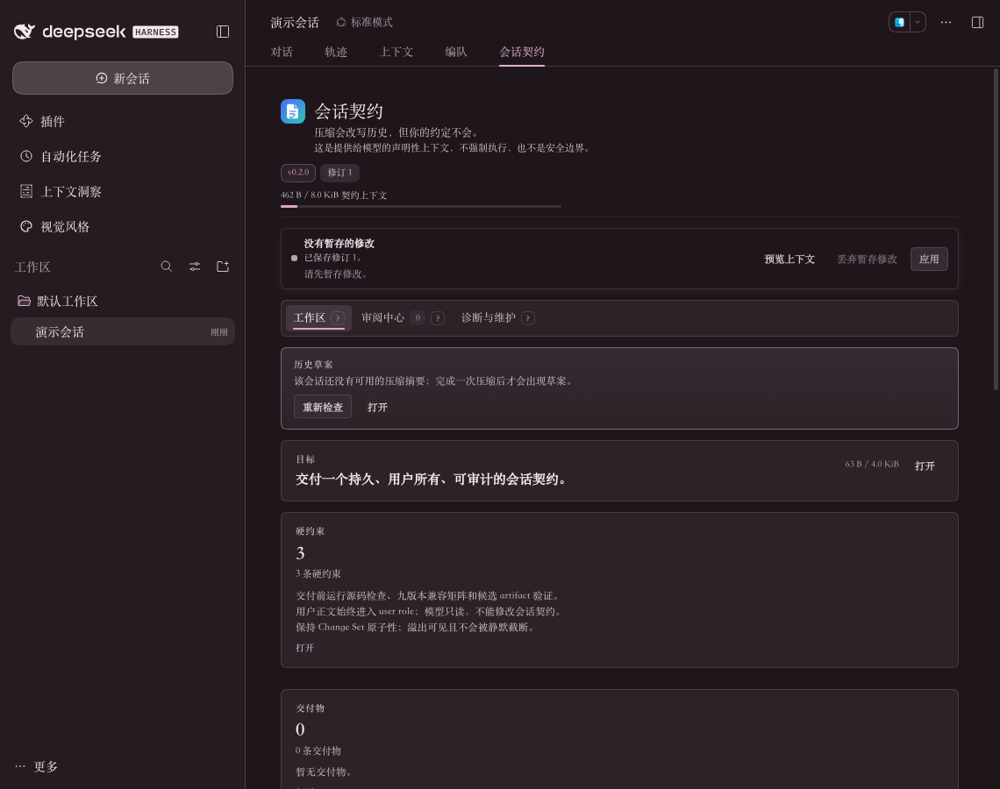
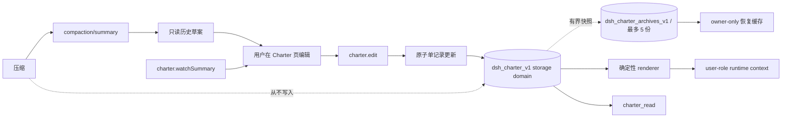

# dsh-charter

[](LICENSE)
[](https://github.com/centella-cream/dsh-charter)
[](docs/design/compatibility.zh.md)
[](package.json)
[](#状态)

[English](README.md) | 中文

> **压缩会改写历史，但不会改写你的承诺。**

`dsh-charter` 是 [DeepSeek Harness](https://github.com/deepseek-ai/deepseek-harness) 的持久化、用户所有的
会话契约插件。目标、硬约束、交付物、证据和依赖关系在上下文压缩后仍然保留，并且始终可查看、可编辑。



> 这是本地 Web profile 中当前 **0.2** Pane 的界面。UI 文案跟随 DSH 当前语言；截图使用演示数据，不发布
> 任何私人 Session 内容。

## 目录

- [状态](#状态)
- [为什么需要](#为什么需要)
- [0.2 核心亮点：约束关系](#02-核心亮点约束关系)
- [其他 0.2 能力](#其他-02-能力)
- [工作原理](#工作原理)
- [安装](#安装)
- [快速开始](#快速开始)
- [会话契约页](#会话契约页)
- [配置](#配置)
- [兼容性](#兼容性)
- [安全与隐私](#安全与隐私)
- [开发](#开发)
- [文档](#文档)
- [贡献](#贡献)
- [License](#license)

## 状态

- **已发布版本：**`0.2.0` — npm `latest` 和 `next`，GitHub Release `v0.2.0`。
- **上一版本：**`0.1.0-rc.6`。
- **主要 DSH 基线：**`0.2.2-rc.1`；九个声明版本通过源码矩阵验证。
- 从 `0.2.0` 起版本号使用普通递增（`0.2.0`、`0.2.1`…），不再使用 `rc` 后缀。

## 为什么需要

压缩会把较早的上下文替换成摘要。摘要可能保留总体任务，却丢掉长期约束，比如“不要改 migrations/”、
“交付前运行测试”或“保持 API 向后兼容”。把这些内容放进 system prompt 又会越过用户内容的权限边界。

`dsh-charter` 专注解决这个问题：

- **独立正本。**每个 Session 只有一个 `dsh-storage-domain` 记录；压缩摘要和 UI 缓存既不写入也不恢复它。
- **用户角色。**用户可编辑正文进入 user-role runtime context，不进入 system message。模型可通过
  `charter_read` 读取，不能写入。
- **确定性重建。**相同的记录 revision 和 renderer 产生字节一致的上下文；`{{...}}` 会被转义，旧版 DSH
  prompt 插值不能改写用户正文。
- **显式预算。**Pane 展示实时上下文计量和分字段字节数；溢出会被拒绝或提示选择，绝不静默截断。
- **原子 Apply。**一个 Change Set 要么完整提交，要么不提交；带 revision 冲突、幂等重试和 Host canonical
  preview digest。
- **安全接入。**已有压缩历史的 Session 可以生成只读草案；用户确认前不会生效。
- **可恢复。**export/restore 仅 owner 可用；Host 每个 Session 最多保留 5 份恢复快照（整个 profile 最多 25 份）；健康记录拒绝覆盖；
  写入结果不确定时只隔离该 Session，等待 Host 重启恢复。
- **逐 Session fail closed。**结构损坏的记录会保留用于诊断，不会被覆盖。

契约是声明，不是强制执行策略。需要机器强制的限制请使用 Host permissions、sandbox policy、hooks 或
执行守卫。

## 0.2 核心亮点：约束关系

0.2.0 最核心的变化，是 deliverable 不再是一份互不相关的顺序清单。一个 deliverable 可以声明对其他
deliverable 的**前置约束**，而这些关系会进入存储契约、校验边界、UI 计划和模型可见 prompt。

```text
测试 (D1) ────────────┐
迁移 (D2) ────────────┴──> 发布 (D3)
```

- **类型化、可校验的关系。**每个 deliverable 可携带 `requires: [id…]`。Host 拒绝自环、重复前置、
  悬空引用、非 active 端点和环；整个 Change Set 原子失败，不会写入半张图。
- **确定性的依赖投影。**standing deliverable 按 canonical 拓扑顺序获得稳定 `D<n>` key；prompt 按前置
  在前、依赖在后的顺序渲染，模型因此知道哪些承诺可以执行、必须先完成什么。
- **派生 readiness。**readiness 由 acceptance、lifecycle、前置 readiness 和 progress 派生：`ready`、
  `waiting`、`blocked`、`dependency-conflict`、`in-progress` 或 `terminal`，不保存容易过期的重复状态。
- **可见、可编辑。**Workspace 展示依赖计划和前置选择器；非法图会显示冲突提示而不是拖垮 Pane，图不一致
  时禁用 Apply。
- **生命周期安全。**archive、restore、supersede、fork 和 proposal acceptance 都会校验或重映射关系；
  `proposedRequires` 让 pending deliverable 引用候选前置条件，接受时解析为正式 requires。
- **有界。**关系集合同样受 record 和 prompt 预算约束，不引入独立的图正本。

依赖是用户编写的**执行约束**，不是强制 sandbox 或权限系统。

## 其他 0.2 能力

- 三个一级区域：**Workspace**、**Review Center**、**Diagnostics & Maintenance**。
- record schema v2、内存 v1 迁移、proposal batch、类型化 provenance 和 objective proposal。
- `summary`/`watchSummary` 及分页 item/proposal/change query；Pane 使用 summary + query，完整 watch 仅作为
  兼容回退。
- pending-only `charter_propose`；用户触发的 message proposal（选择器、可编辑正文、kind）。
- Evidence Integrity 与 Fact Validity，以及 owner-only 注册式验证器：
  `workspace.path-exists`、`workspace.file-digest`、`workspace.file-contains`。
- message/compaction-summary/agent-tool batch 的 source integrity 投影复算；fork source integrity 明确返回
  `unsupported`。
- fork 的 item/validity/evidence/依赖重映射；Recovery Center 支持 export/initialize，以及从最多 5 份的
  owner-only 快照缓存恢复。
- 中英文 UI、明暗主题、键盘 focus 状态和容器查询响应式布局。

## 工作原理



Host 在 `session/created` 和首次 prompt 前的 `agent/created` 初始化记录。浏览器注册 conversation-view
入口；Pane 和 `charter.watchSummary` 读取同一个 revisioned projection。`charter.bootstrap` 从最新可用
compaction summary 返回只读草案，不写 storage。

## 安装

当前公开版本是 `0.2.0`。可复现 profile 请安装精确版本：

```bash
dsh plugin --profile web add dsh-charter@0.2.0
```

离线机器或需要精确验证 artifact 时，安装已发布 tarball：

```bash
npm pack dsh-charter@0.2.0
dsh plugin --profile web add ./dsh-charter-0.2.0.tgz
```

Desktop 请使用 **Desktop → Plugins → Install/Update**；若 Desktop 构建支持本地插件导入，也可导入同一
tarball。`dsh plugin --profile desktop` 会被拥有该 profile 的 Electron 应用拒绝。

### 要求

- DSH：仅支持[兼容矩阵](docs/design/compatibility.zh.md)中列出的版本；`0.2.1+` 才具备 per-Peer Remote
  resource authorization。
- Node.js **`^22.19.0 || >=24.0.0`**。
- Web 或 Desktop profile。

可复现 profile 请固定精确版本。pnpm 的 release-age 策略可能让刚发布的版本暂时不被 `@next`/`@latest`
解析；不要绕过兼容门禁安装未声明的旧版本。

## 快速开始

### 新建契约

1. 打开 live Session，选择 **Charter** 标签页。
2. 设置 objective，添加 invariant/deliverable，按需配置 `requires`。
3. 使用 **Preview context** 检查精确的 user-role 文本和字节数。
4. 点击 **Apply**。revision 冲突会保留草案并显示服务器 revision。

### 接入已有压缩历史

1. 打开一个在当前 Host 进程中 live 的旧 Session。
2. 打开 **Charter**。若契约为空，Review Center 会从最新可用 `compaction/summary` 生成草案。
3. 审阅或编辑候选，取消勾选过期内容，只应用需要生效的部分。

当前 Host 进程中不 live 的 Session 以只读方式展示；需要编辑时请先在这里启动该 Session。

## 会话契约页

Pane 从 Session 视图打开。宽屏使用左侧区块导航，窄屏使用横向 tab。

| 区域 | 用途 |
| --- | --- |
| **Workspace** | 当前目标、硬约束、交付物、约束计划、未解决阻塞 |
| **Review Center** | pending proposal batch、历史草案、非当前条目、近期变更 |
| **Diagnostics & Maintenance** | prompt/preview 健康、source integrity、validator、record health、export/restore、capabilities |

Pane 有 sticky 的 Preview / Discard / Apply 工具栏，展示精确的模型可见上下文，并按字段报告预算。长文本
会被拆分，不会静默截断；pending proposal 始终可见、可审阅；溢出会变成可审阅 proposal，而不是任意
active-count 失败。

## 配置

默认值在 `cordis.patch.yml`。在 profile patch 中覆盖：

```yaml
- id: charter
  config:
    maxPromptBytes: 8192
    maxObjectiveBytes: 4096
    maxItemBytes: 1024
    contextOrder: 130
```

| 字段 | 默认值 | 含义 |
| --- | ---: | --- |
| `maxPromptBytes` | 8192 | 仅 charter contribution 的 UTF-8 上下文预算 |
| `maxObjectiveBytes` | 4096 | objective 的 UTF-8 预算 |
| `maxItemBytes` | 1024 | 单条 item 文本预算 |
| `maxItems` | 512 | 所有条目存储上限 |
| `maxPendingItems` | 512 | pending proposal 上限 |
| `maxOps` | 1024 | 单次 Apply 的操作数 |
| `maxRecordBytes` | 1048576 | 单个 Session 记录 |
| `historyLimit` | 64 | 最近 history receipt |
| `maxHistoryBytes` | 131072 | 最近 history 字节 |
| `mutationLimit` | 128 | 最近 mutation receipt |
| `maintenanceLimit` | 16 | 最近 initialize/restore receipt |
| `maxRecoveryBytes` | 4194304 | 完整 recovery archive 预算 |
| `contextOrder` | 130 | runtime-context 顺序 |

模型可见容量只有 `maxPromptBytes`；`maxItems` 和 `maxPendingItems` 约束存储。

## 兼容性

| DSH 版本 | 状态 |
| --- | --- |
| `0.1.7-rc.2` | 支持（最低版本） |
| `0.2.0-rc.1` / `0.2.0-rc.2` | 支持 |
| `0.2.1-rc.1` / `0.2.1-rc.2` / `0.2.1-rc.3` / `0.2.1-rc.4` / `0.2.1-rc.5` | 支持 |
| `0.2.2-rc.1` | 支持（主基线） |
| `0.3.x` | 验证前不声明 |

“支持”表示该版本通过 typecheck、build、测试和 Remote/client smoke，并具备[兼容矩阵](docs/design/compatibility.zh.md)
中记录的 profile 证据。`0.1.7` / `0.2.0` 没有 per-Peer Remote resource authorization，仅应在可信单操作者
环境中使用。

## 安全与隐私

- 用户正文不会进入 system-role message。
- 模型没有写权限；`charter_read` 只读。
- `owner` 可执行包括 purge 在内的所有编辑；`user` 可执行普通编辑但不能 purge；Host-only validator 结果
  不能由客户端 edit 路径伪造。
- 注册式 validator 仅 owner 可运行，只读取 Session workspace 内文件，受文件/字节/deadline 边界约束，
  不执行任意 shell。
- 普通日志只包含 id、kind、revision 和错误码，不包含用户正文。
- 契约不是权限系统。威胁模型和报告方式见 [SECURITY.md](SECURITY.md)。

## 开发

```bash
npm ci
npm run check              # typecheck + build + remote/client smoke + Vitest
npm run smoke:package      # packed tarball installability
npm run verify:compaction  # 手动真实模型 compaction 检查
node scripts/verify/compat-matrix.mjs --versions all --allow-new-release
```

当前源码证据：**36 个测试文件 / 440 个测试**，九版本 DSH 矩阵 **9/9**、每版 **440/440** 通过。精确命令
和 source/local-matrix/exact-artifact/manual 证据的区别见[验证记录](docs/verification.zh.md)。

CI 在 Node `22.19.0` 和 `24` 上运行 `npm run check` 与 `npm run smoke:package`；release candidate 和 promotion 是独立门禁。green candidate 不等于已发布。

## 文档

- [文档索引与约定](docs/README.md)
- [用户与运维指南](docs/user-guide.zh.md)
- [兼容矩阵](docs/design/compatibility.zh.md)
- [验证记录](docs/verification.zh.md)
- [Charter 设计 v1](docs/design/charter-design-v1.zh.md)
- [0.2 工作区设计](docs/design/charter-workspace-v2.zh.md)
- [Release notes](docs/release-notes/README.md)
- [发布清单](docs/releasing.zh.md)
- [版本路线](docs/design/version-roadmap.zh.md)

历史设计、审查和发布计划冻结在 `docs/history/`；研究笔记在 `docs/research/`。

## 贡献

修改 Host 契约、prompt 边界或 client bundle 前，请阅读 [CONTRIBUTING.zh.md](CONTRIBUTING.zh.md) 和
[Code of Conduct](CODE_OF_CONDUCT.md)。安全报告遵循 [SECURITY.md](SECURITY.md)。远程仓库只保留 `main`；
开发分支仅在本地，线性合入后再 push。

## License

[MIT](LICENSE) © 2026 dsh-charter contributors。
