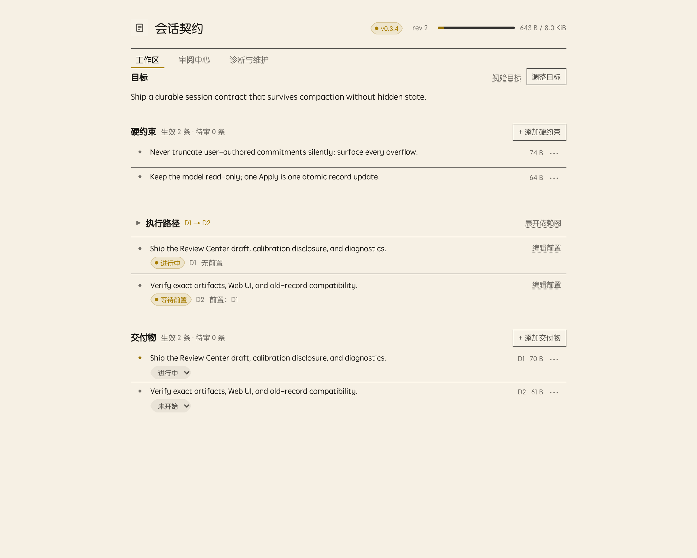
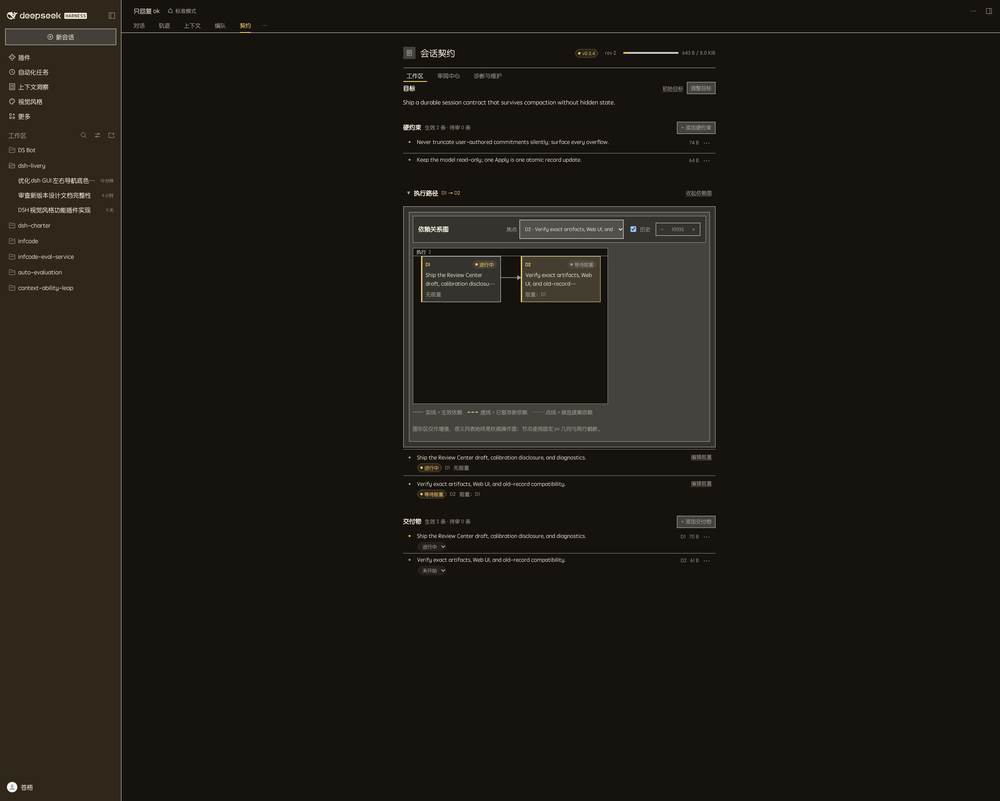

# dsh-charter

[](LICENSE)
[](https://github.com/centella-cream/dsh-charter)
[](docs/design/compatibility.zh.md)
[](package.json)
[](#状态)

[English](README.md) | 中文

> **压缩会改写历史，但不会改写你的承诺。**

`dsh-charter` 是 [DeepSeek Harness](https://github.com/deepseek-ai/deepseek-harness) 的持久化、用户所有的会话契约插件。目标、硬约束、交付物、证据和依赖关系在上下文压缩后仍然保留，并且始终可查看、可编辑。





Pane 把工作区、审阅中心和诊断放在同一文档列中。截图只裁剪右侧 Pane、跟随当前系统主题，并使用与 README 语言一致的合成演示数据；中文图复用 `0.3.3` 演示会话的三条中文交付物。

## 状态

- **当前已发布：**`0.3.3` — 结构化草案抽取、自动中英文语言跟随、重复折叠、稳定草案 ref、非阻塞后台翻译和自适应分批翻译。
- **开发候选：**`0.3.4` — opt-in、consent 门禁的草案校准：语义聚合、可读改写、原文/校准稿审阅、`c-*` apply provenance、真实模型校准状态与诊断。**未达到发布条件：**v8 自适应分批内核已通过真实 10 轮默认参数工程测试，但批级 UI/partial 状态、披露 v2 重新确认与 A/B/人工验收仍未完成。
- **上一版本：**`0.3.2` — 无障碍/证据收敛；`0.3.1`、`0.3.0` 是更早基线。
- **主要 DSH 基线：**`0.2.2-rc.5`；十三个声明版本通过源码矩阵验证。
- 从 `0.3.4` 起，**Plugins** 页面显示本地化标题和带版本号的功能说明，并明确校准的数据发送限制。

## 核心能力

- **持久、用户所有的权威。** 每个 Session 一个 `dsh-storage-domain` record 是唯一权威；模型没有写入能力，Apply 是单次原子编辑。
- **文档感 Pane。** 顶部下划线 tabs、对齐行、字节计数、prompt meter，工作区/审阅中心/诊断共用视觉语言。
- **结构化草案审阅。** 压缩摘要变成只读候选：句边界切分、oversized/truncated 标记、重复折叠、稳定 `d-*` ref 和只读 Apply。
- **可选智能校准。** opt-in、consent 门禁的 Host 模型调用可聚合/改写候选（`c-*`），显示 uncertain/merged/split、原文 excerpt 和“用原文”。默认关闭。
- **语言跟随。** 先显示源语言草案，需要时后台分批翻译；可配置专用翻译模型。
- **依赖图。** 本地 ego-scoped 图和语义列表共享同一 Change Set；图是增强视图，不是第二权威。
- **按设计有界。** 上下文/条目/记录/操作预算可见；溢出变成 pending proposal 或显式拒绝，从不静默截断。

## 安装

最新已发布版本是 `0.3.3`：

```bash
dsh plugin --profile web add dsh-charter@0.3.3
# 离线/精确 artifact：
npm pack dsh-charter@0.3.3
dsh plugin --profile web add ./dsh-charter-0.3.3.tgz
```

`0.3.4` 是当前开发候选：

```bash
npm pack
dsh plugin --profile web add ./dsh-charter-0.3.4.tgz
```

Desktop 使用 **Plugins → Install/Update**（支持本地 tarball 的构建可导入）。可复现 profile 请固定精确版本；不要绕过兼容门禁安装未声明的旧版。

### 更新与回滚

使用精确版本或本地 tarball 更新。client bundle 可通过 profile 热替换；如果安装结果已成功但新的 Host service/Remote 方法仍未生效，重新加载 Host 或 Desktop 一次即可。完整退出/重启只是兜底，不是客户端改动的默认要求。回滚时安装上一个精确版本（当前已发布为 `0.3.3`）；`0.3.2`/`0.3.3`/`0.3.4` 写入的 record 无需迁移仍可读取。

### 要求

- DSH 版本见[兼容矩阵](docs/design/compatibility.zh.md)；主基线 `0.2.2-rc.5`。
- Node.js `^22.19.0 || >=24.0.0`。
- Web 或 Desktop profile；`0.2.1+` 才具备 per-Peer Remote authorization。

## 快速开始

1. 在 DSH 打开 Session，切到「契约」。
2. 在工作区添加目标、硬约束、交付物，或在审阅中心检查压缩历史草案。
3. 检查 Change Set 后原子 Apply。
4. 压缩后的 Session 会从最近一次可用压缩摘要生成审阅草案；只接受/应用你确认的内容。

## 配置

默认值在 `cordis.patch.yml`，在 profile config 覆盖同名键。常用配置：

```yaml
- id: charter
  config:
    maxPromptBytes: 8192
    maxObjectiveBytes: 4096
    maxItemBytes: 1024
    contextOrder: 130
    languageFollow: true
    languageFollowTimeoutMs: 60000
    # 可选专用翻译路由：
    # languageFollowProvider: your-provider
    # languageFollowModel: your-fast-model
    calibration:
      enabled: false
      consentVersion: 0
      maxCandidates: 32
      batchCandidates: 8
      maxOutputTokens: 4096
      maxConcurrency: 3
```

| 字段 | 默认 | 说明 |
| --- | ---: | --- |
| `maxPromptBytes` | 8192 | 契约 contribution 的 UTF-8 预算 |
| `maxObjectiveBytes` | 4096 | objective 字节预算 |
| `maxItemBytes` | 1024 | 单条文本预算 |
| `maxItems` / `maxPendingItems` | 512 / 512 | 条目/pending proposal 上限 |
| `maxOps` / `maxRecordBytes` | 1024 / 1048576 | 单次 Apply 操作数/记录预算 |
| `contextOrder` | 130 | runtime context 排序 |
| `languageFollow` | true | 跟随当前 `zh`/`en` DSH 界面语言 |
| `languageFollowTimeoutMs` | 60000 | 后台翻译批次等待上限 |
| `languageFollowProvider` / `.model` | 未设置 | 可选专用翻译路由 |
| `calibration.enabled` | false | opt-in 智能草案校准 |
| `calibration.consentVersion` | 0 | 已确认披露版本；阅读披露后设为 `1` |
| `calibration.provider` / `.model` | 未设置 | 可选专用校准路由 |
| `calibration.maxCandidates` | 32 | 全局校准候选上限 |
| `calibration.batchCandidates` | 8 | 单批候选数 |
| `calibration.maxOutputTokens` | 4096 | 单批输出 token 上限 |
| `calibration.maxConcurrency` | 3 | 并发批数 |
| `calibration.maxTotalOutputTokens` | 16384 | 单次校准总输出预算 |
| `calibration.timeoutMs` / `runTimeoutMs` | 45000 / 120000 | 单批/整次超时 |

校准按有界批次把压缩草案文本与当前契约条目发送到配置的 provider/model；调用计入模型用量（含 reasoning tokens）。结果始终是待审提案，接受前不进入 standing prompt；缓存仅在内存。启用前必须在审阅中心阅读披露。

## 兼容性

| DSH 版本 | 状态 |
| --- | --- |
| `0.1.7-rc.2` | 支持（最低版本） |
| `0.2.0-rc.1` / `0.2.0-rc.2` | 支持 |
| `0.2.1-rc.1` … `0.2.1-rc.5` | 支持 |
| `0.2.2-rc.1` … `0.2.2-rc.5` | 支持（主基线：`0.2.2-rc.5`） |
| `0.2.3-alpha.x` | 不支持 |
| `0.3.x` | 验证前不声明 |

`engines.dsh` 限定 0.2 线；精确 `dshReleases`/peer 列表是矩阵验证支持集。详见[兼容性](docs/design/compatibility.zh.md)。

## 安全与隐私

- 用户文本保持 user-role；模型没有写入能力。
- 校准和语言归一都是显式模型调用；插件不新增遥测或上传路径，凭据留在 DSH。
- 语言跟随会使用配置的会话/专用模型；设置 `languageFollow: false` 可避免该调用。
- Record 存在 Session 的 `dsh_charter_v1` domain；导出/恢复是 owner-only maintenance。
- 安全问题请按 [SECURITY.md](SECURITY.md) 私下报告。

## 开发

```bash
npm ci
npm run check                    # typecheck + build + smokes + Vitest + token gate
npm run verify:ui-metrics -- --gate=final
npm run smoke:package
node scripts/verify/recovery-smoke.mjs --artifact dist/dsh-charter-<version>.tgz --sha256 SHA256SUMS
node scripts/verify/compat-matrix.mjs --versions all
```

见 [CONTRIBUTING.md](CONTRIBUTING.md)、[verification](docs/verification.md) 和[发布流程](docs/releasing.md)。Public CI 在 Node 22.19.0/24 上运行 check 与 package smoke；exact-artifact、兼容性和浏览器/Desktop 门禁独立执行。

## 文档

- [用户指南](docs/user-guide.zh.md)
- [版本与路线](docs/design/version-roadmap.zh.md)
- [结构化抽取设计](docs/design/charter-draft-extraction-v1.zh.md)
- [草案校准设计](docs/design/charter-draft-calibration-v1.zh.md)
- [兼容矩阵](docs/design/compatibility.zh.md)
- [文档索引](docs/README.zh.md)

## License

MIT，见 [LICENSE](LICENSE)。
