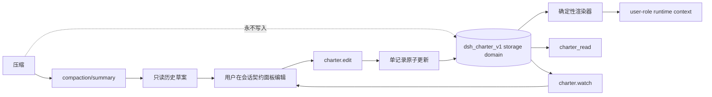

# dsh-charter

[](LICENSE)
[](https://github.com/centella-cream/dsh-charter)
[](docs/design/compatibility.zh.md)
[](package.json)
[](#状态)

[English](README.md) | 中文

> **压缩会改写历史，但你的约定不会。**

`dsh-charter` 为 [DeepSeek Harness](https://github.com/deepseek-ai/deepseek-harness) 提供持久、用户所有的
「会话契约」：目标、硬约束和交付物在上下文压缩后仍然可见，并且随时可编辑。


暗色与窄屏证据：[暗色](docs/assets/charter-pane.dark.png)、[窄屏](docs/assets/charter-pane.narrow.png)。

> 真实中文 Web profile，同时安装 `dsh-context`。标签顺序为「对话」「轨迹」「上下文」「编队」「会话契约」；
> 面板全部文案跟随 DSH 当前语言。

## 目录

- [为什么需要](#为什么需要)
- [亮点](#亮点)
- [工作原理](#工作原理)
- [安装](#安装)
- [快速开始](#快速开始)
- [会话契约标签页](#会话契约标签页)
- [配置](#配置)
- [兼容性](#兼容性)
- [安全与隐私](#安全与隐私)
- [开发](#开发)
- [文档](#文档)
- [致谢](#致谢)
- [贡献](#贡献)
- [许可证](#许可证)

## 为什么需要

压缩会用摘要替换较早的历史。摘要可能保留总体任务，却悄悄丢掉持续约束，例如「不要修改 migrations/」、
「交付前跑测试」、「保持公共 API 向后兼容」。把这些内容放进 system prompt，又会越过用户内容的权限边界。

`dsh-charter` 只解决一个窄问题，但把它解决好：

- **独立正本**：每个 Session 一条 `dsh-storage-domain` 记录，压缩摘要和 UI 缓存永远不是写入者或恢复源。
- **保持 user role**：可编辑的用户正文通过 `systemPrompt.context()` 注入，绝不进入 system-role 消息。
  模型可以经 `charter_read` 读取，但不能写入。
- **确定性重建**：相同 revision 和渲染器版本产生逐字节一致的上下文；`{{...}}` 片段会被转义，旧版 DSH
  的 prompt 插值器无法改写用户文本。
- **显式预算**：面板显示实时上下文预算和每个字段的字节计数；超限会被拒绝或交给用户选择，绝不静默截断。
- **原子 Apply**：一次编辑要么全部提交，要么完全不提交；支持 revision 冲突与幂等重试。
- **安全的上手**：已有压缩历史的 Session 会得到一份只读的「历史草案」；用户审阅并应用前不生效。
- **草稿不随页面切换丢失**：暂存修改、打开中的行内编辑器和已审阅的历史草案都属于 Session 而不是当前挂载
  的标签页；切到对话再回来不会丢失。
- **逐 Session 降级与 fail closed**：单条**可加载但违反严格内部 schema/一致性检查**的存储记录只禁用该 Session
  （原始字节保留以便诊断）；后来收紧预算的会话契约显示为 **超预算（over-budget）** 状态而不是损坏，不被注入，
  并可通过删除/归档收敛回预算内。**外层 JSON 不可读**是已记录的残留风险：JSON storage backend 会把它当作记录
  不存在，插件无法与"记录缺失"区分（见验证记录 4.5）。
- **可恢复的应用**：结果未知的请求重试时复用同一 mutation id；revision 冲突提供“应用到最新修订”，而不是
  直接丢弃草稿。
- **可见的构建标识**：会话契约头部在 revision 和条目计数旁显示当前插件版本，截图或支持报告可直接识别构建；
  如果客户端版本常量与 `package.json` 不一致，回归测试会失败。

会话契约是**声明**，不是执行策略。需要机器强制的限制请使用 Host 权限、sandbox、hook 或工具守卫。

## 亮点

- 原始目标与当前目标分离；普通编辑永远不会改写原始目标。
- `invariant` 与 `deliverable` 条目，review / lifecycle / verification / progress 四个维度正交。
- 会话头部标签页，以稳定的高 order（1000）注册一次，因此排在「对话」「轨迹」和常见插件标签之后，不会重新注册。
- 可在 **概览 / 目标 / 硬约束 / 交付物 / 历史草案 / 上下文** 间导航的紧凑面板。
- 吸顶的预览/丢弃/应用工具栏，以及模型实际收到的 user-role 上下文精确预览。
- 从 `compaction/summary` 确定性生成历史草案；不调用模型，不自动写入。
- 中英文界面、明暗主题、键盘焦点和容器查询响应式布局。
- 自解释导航：每个栏目都有悬停/聚焦 `?` 帮助徽标，展示一句话栏目说明。
- 上下文预览支持“格式化 JSON / 精确文本”；格式化视图便于阅读，精确视图保留模型实际字节。
- 只读 `charter_read` 工具（紧凑 standing 投影）；fork 一次性复制；重启、压缩、卸载、记录损坏和预算收紧时
  都有明确降级状态。

## 工作原理



Host 在 `session/created` 时初始化记录，并在首次 prompt 前的 `agent/created` 等待初始化完成。浏览器注册
`conversation.view` 标签页；面板和 `charter.watch` 使用同一份 revisioned view。`charter.bootstrap` 只读取
最近一次可用压缩摘要（若最新摘要无法产出候选，则回退到更早的可用摘要）并返回草案，不写入 storage。

## 安装

### 当前发布状态

- **最新已发布 RC：** `0.1.0-rc.4`（npm `latest` 和 `next`，GitHub Release）。
- **已定版但 npm 延迟：** `0.1.0-rc.5` 已打 tag（`v0.1.0-rc.5`），candidate 全绿，产物 digest 不可变；
  npm 发布和 GitHub prerelease 延迟，尚不能从 npm 安装。
- **当前源码：** `0.1.0-rc.6`，未发布、未打 tag。当前只包含文档、UI 帮助/预览和流量观测工作，不是已发布运行时变更。
- `0.1.0-rc.5` 只包含审阅、恢复、无障碍和发布证据硬化，不新增 0.2 能力线。

普通使用请安装最新已发布版本。不要假设 `dsh-charter@0.1.0-rc.5` 或 rc.6 已能从 registry 安装；最新已发布
RC 仍是 rc.4。频道策略是 RC 发布到 `next`，并在稳定版出现前让 `latest`
也指向最新 RC（npm 会保留 `latest` tag，由我们决定其指向；这是我们的策略，不是 npm 的强制要求）。

完整的恢复/记录健康契约见[使用与运维指南](docs/user-guide.zh.md)和[验证记录](docs/verification.zh.md)。
简要说明：记录使用结构化健康状态；DSH `0.2.1+` 上 export/restore 为 owner-only；健康记录不会被覆盖；
写入被拒绝时只围栏该 Session，直到 Host 重启。

> **通过 npm/CLI 安装时请固定精确版本。** pnpm 11+ 默认启用 `minimumReleaseAge = 1440` 分钟（24 小时），
> 新发布的版本在这个窗口内不会参与正常解析。此时不带版本的安装或更新（`dsh-charter`、`@next`、`@latest`）
> 可能解析到旧版本；如果该旧版本没有声明支持当前 DSH runtime，会被兼容性检查拒绝。精确发布版本不经过这条
> 无版本解析路径。不要通过 exact-version exemption 强行启用未声明兼容的旧版本。

### 环境要求

- DSH：只支持[兼容矩阵](docs/design/compatibility.zh.md)中列出的版本（`0.1.7-rc.2`、`0.2.0-rc.1`/`rc.2`、
  `0.2.1-rc.1`/`rc.2`/`rc.3`/`rc.4`）。在扩展矩阵前不声明支持更新的 stable/RC 版本；per-Peer Remote 资源授权需要 `0.2.1+`。
- Node.js **`^22.19.0 || >=24.0.0`**。
- Web 或 Desktop profile。

### 从 npm 安装（推荐）

#### Web profile — 安装精确版本

```bash
# 固定最新已发布 RC；它处于 pnpm release-age 窗口内时这是必需做法。
dsh plugin --profile web add dsh-charter@0.1.0-rc.4
```

固定精确版本可以保证 profile 可复现。`@next` 和 `@latest` 只是 dist-tag，同样受 pnpm release-age 策略影响，
不能可靠地用来安装刚发布的 RC。registry 不可达、或需要精确发布产物时，使用下面的离线 tarball 回退方式。

`dsh-charter@0.1.0-rc.5` **尚不能从 npm 安装**（已定版但发布延迟）；rc.6 尚无 tagged candidate。切换用户
profile 前请等正式发布。

重启 `dsh web`（或等待 profile HMR 重新组合），然后刷新页面。profile 的 `package.json` 会增加依赖和
bundle 选择。

#### Desktop — 通过 Plugins 安装

打开 **Desktop → Plugins**，对 `dsh-charter` 使用 **Install**/**Update**。当前 Desktop Plugins UI 不支持输入
精确的 npm 版本 spec，而是通过插件目录解析版本。因此，新版本仍处于 pnpm release-age 窗口内时，目录可能先
解析到旧版本，然后被 DSH 兼容性检查拒绝。遇到这种情况，请等目标版本离开 release-age 窗口后重试
**Install**/**Update**。不要关闭该策略，也不要对未声明兼容的旧版本授予 exact-version exemption 来强行安装。

如需立即安装或精确安装，并且你的 Desktop 构建支持导入本地插件，请使用下面的离线 tarball 回退方式；否则
Plugins UI 是 Desktop 唯一受支持的安装路径。Desktop 管理插件生命周期并热更新新的 bundle。

### 离线 / 本地 tarball 回退

作为离线/air-gapped 机器、精确发布产物校验，或支持导入本地插件的 Desktop 构建的备用安装路径。已发布版本
的 GitHub Release 附带与 `npm publish` 完全相同的 tarball 和 `SHA256SUMS`。

```bash
# 已发布 rc.4 产物（与 GitHub Release 相同字节）：
gh release download v0.1.0-rc.4 --pattern '*.tgz' --pattern SHA256SUMS
shasum -a 256 -c SHA256SUMS
dsh plugin --profile web add ./dsh-charter-0.1.0-rc.4.tgz
```

已定版的 rc.5 候选可从 tag 构建/打包并作为发布证据，不作为普通用户安装路径：

```bash
git checkout v0.1.0-rc.5
npm install && npm run build && npm pack
dsh plugin --profile web add ./dsh-charter-0.1.0-rc.5.tgz
```

当前 rc.6 树没有 tagged candidate；在 candidate 和 release evidence 存在前，不要分发本地构建的 rc.6 tarball。

`dsh plugin --profile desktop` 会被拥有该 profile 的 Electron app 拒绝；请使用 Desktop 的 Plugins 页面或该
profile 自己的包管理器。源码开发流程见 [CONTRIBUTING.zh.md](CONTRIBUTING.zh.md)；不要把 `git clone` 当作普通
用户的安装方式。

### 更新

- **Web（npm）**：安装精确已发布目标版本，例如
  `dsh plugin --profile web add dsh-charter@0.1.0-rc.4`，然后重启/刷新；固定版本 profile 继续使用显式版本。
  新版本发布后不要立即使用裸 `@next`/`@latest`，pnpm 的 release-age 策略可能解析到旧版本；rc.5 正式发布前
  不要切换；
- **本地 tarball**：重新构建/下载新 tarball，并重复本地安装命令；这条路径绕过 registry 的 release-age 解析；
- **Desktop**：使用 **Plugins → Install/Update**。UI 没有精确 npm 版本选择器，因此会遵循插件目录和
  release-age 策略。如果解析到旧版本并被兼容性检查拒绝，等目标版本成熟后重试；对支持本地插件导入的构建，
  使用离线 tarball 回退。Desktop 会热更新。

## 快速开始

### 已有压缩历史的会话

1. 打开一个**已经触发过压缩、且当前 Web 进程里是 live** 的旧会话。
2. 打开「会话契约」。如果会话契约为空，插件会读取最近一次 `compaction/summary`，出现「历史草案」标签。
3. 检查/编辑候选内容，取消不合适的勾选，点击 **应用草案**。只有这时内容才生效并进入下一次模型请求。

历史抽取是确定性启发式：选择高信号章节，并把长候选拆成多条而不是截断。人工审阅是强制的。

### 新会话

1. 在已开始的会话中打开「会话契约」。
2. 设置目标。
3. 在对应 section 添加硬约束和交付物。
4. 用 **预览上下文** 查看精确的 user-role 文本和字节数。
5. 点击 **应用**。若 revision 冲突，草稿会保留并显示服务端最新 revision。

## 会话契约标签页

标签页从会话头部打开，以稳定的高 order（1000）注册一次，因此排在「对话」「轨迹」和常见插件标签之后。宽屏使用
左侧 section 导航，窄屏使用横向 tab：

| Section | 用途 |
| --- | --- |
| **概览** | 目标摘要、硬约束/交付物卡片、预算、历史草案入口 |
| **目标** | 编辑或调整目标；原始目标不可改写 |
| **硬约束** | 添加、编辑、替换、归档、清除、验证 |
| **交付物** | 同样的操作，外加交付进度 |
| **历史草案** | 始终可见：应用从最近一次可用压缩摘要抽取的草案，或查看当前 bootstrap 阶段并重新检查 |
| **上下文** | 精确的 user-role runtime context、字节数和限额 |

「会话契约」激活时独占整个阅读区域：对话框会被隐藏，切回「对话」时草稿原样恢复。审批/提问/计划审阅
等必须保留的输入位不会被隐藏。

历史草案候选多于上下文预算时，多出的候选会在同一次原子 Apply 中保存为**待审提案**，仍然可见、可审阅；
不会因为任意 per-kind active 条数上限而拒绝整个草案。

预算在界面各处可见。超长草案条目会拆成多个候选，超限字段高亮。契约上下文预算是门槛：历史草案放不下时，
剩余候选保存为待审提案，而不是阻塞整个导入。只有真实的字段、存储或单批限制才会禁用 Apply。

## 配置

默认值写在 `cordis.patch.yml`，可在 profile patch 中覆盖：

```yaml
- id: charter
  config:
    maxPromptBytes: 8192
    maxObjectiveBytes: 4096
    maxItemBytes: 1024
    contextOrder: 130
```

| 字段 | 默认 | 说明 |
| --- | ---: | --- |
| `maxPromptBytes` | 8192 | 仅会话契约 contribution 的 UTF-8 预算（不含历史消息、system、tools 和其他 context） |
| `maxObjectiveBytes` | 4096 | 目标文本的 UTF-8 上限 |
| `maxItemBytes` | 1024 | 单条条目文本上限 |
| `maxItems` | 512 | 全部条目存储上限 |
| `maxPendingItems` | 512 | pending 提议上限 |
| `maxOps` | 1024 | 单次 Apply 的 op 数 |
| `maxRecordBytes` | 1048576 | 单条 Session record 上限 |
| `historyLimit` | 64 | 近期 history 条数 |
| `maxHistoryBytes` | 131072 | 近期 history 字节上限 |
| `mutationLimit` | 128 | 近期 mutation 回执上限 |
| `maintenanceLimit` | 16 | 最近的 initialize/restore 回执（最小 1） |
| `maxRecoveryBytes` | 4194304 | 完整恢复归档预算（≥ 记录预算 + 64 KiB，硬上限 16 MiB） |
| `contextOrder` | 130 | runtime context 排序；默认在 sandbox/approval/subagent 之后 |

模型可见容量只有 `maxPromptBytes`；active invariant/deliverable 不再单独设条数上限。`maxItems` 和
`maxPendingItems` 约束存储。历史草案放不进上下文预算时，能放下的候选会直接生效，其余保存为待审提案，
不会被拒绝、截断或静默丢弃。

## 兼容性

| DSH 版本 | 状态 |
| --- | --- |
| `0.1.7-rc.2` | 支持（最低版本） |
| `0.2.0-rc.1` / `0.2.0-rc.2` | 支持 |
| `0.2.1-rc.1` / `0.2.1-rc.2` / `0.2.1-rc.3` / `0.2.1-rc.4` | 支持（主基线：`0.2.1-rc.4`） |
| `0.1.5-rc.1` 及更早 | 不支持 |
| `0.2.2-rc.x`、`0.3.x` | 验证前不声明 |

“支持”表示该版本通过 typecheck、build、测试以及 Remote/client smoke。fresh Web profile 安装、启动、页面和
client bundle 检查已在 `0.1.7-rc.2`、`0.2.0-rc.2`、`0.2.1-rc.2`、`0.2.1-rc.4` 通过；其他版本是 API/build
级验证。真实模型 compaction 端到端已于 **2026-10-22 记录 PASS**（一个匿名评估会话；326 条消息 / 约 228k
tokens 被压缩，revision 1 契约携带匹配 digest 存活；见不可变 [v0.1.0-rc.4 验证记录 8.4](https://github.com/centella-cream/dsh-charter/blob/v0.1.0-rc.4/docs/verification.md#84-recorded-real-model-run-2026-10-22)）。完整矩阵和降级说明见
[兼容文档](docs/design/compatibility.zh.md)。`0.1.7`/`0.2.0` 没有 per-Peer Remote 资源授权，只能在可信
单操作者环境使用。

## 安全与隐私

- 用户正文永远不进入 system-role 消息。
- 模型没有会话契约写能力；`charter_read` 只读。`standing` 以紧凑形式返回完整的当前工作集（受 record 配额
  约束，省略仅供调试的 id/review/lifecycle，避免元数据撑大工具结果）；`all` 调试页最多 64 条 / 32 KiB
  （按最终 envelope 计算），并在 `truncated` 中报告省略数量。`standing` 没有固定字节上限，最大规模的
  会话契约可能产生较大的 tool result；对 standing 分页已列为后续工作。
- Actor 策略：`owner` 可执行所有编辑（含永久清除）；`user` 可做普通编辑但不能 purge；`host` 在 Remote
  edit 路径上被拒绝。记录绑定 `createdAt`、`cwd`、`parentSession`；同一 Session id 的不同 lifecycle 会被拒绝。
- 普通日志只记录稳定 id、kind、revision 和错误码，不记录用户正文。
- 会话契约不是权限系统；威胁模型和报告方式见 [SECURITY.zh.md](SECURITY.zh.md)。

## 开发

```bash
npm run typecheck        # 严格 TypeScript
npm test                 # build + Vitest
npm run build            # Host ESM + 单文件浏览器 bundle + smoke
npm run check            # typecheck + build + tests
npm run smoke:package    # 打包产物可安装性
npm run verify:compaction # 手工真实模型 compaction 校验（不在 check 中）
```

测试覆盖纯内核、真实 Host 组合、storage domain、Remote framing、历史抽取、客户端状态和 factory bundle
注册。当前树有 **368 个测试**；七版本矩阵在所有声明版本上通过。当前证据见[验证记录](docs/verification.zh.md)。

## 致谢

本项目的设计调研受益于两个独立的社区项目：

- [dsh-context-enhancement](https://github.com/chuxindd/dsh-context-enhancement)：per-record 存储、Session
  lifecycle fence、持久化成功后发布、revision 冲突处理；
- [dsh-ontology](https://www.npmjs.com/package/dsh-ontology)：纯领域内核、稳定错误码、写前 overlay 校验。

它们启发了本项目的设计评审；本项目没有复制其源码，两个项目也不为 `dsh-charter` 背书。详细对比见
[调研记录](docs/research/charter-research.zh.md)。

## 文档

- [设计规格](docs/design/charter-design.zh.md)
- [使用与运维指南](docs/user-guide.zh.md)
- [兼容矩阵](docs/design/compatibility.zh.md)
- [验证记录](docs/verification.zh.md)
- [发布说明](docs/release-notes/README.md)
- [版本路线](docs/design/version-roadmap.zh.md)
- [发布清单](docs/releasing.zh.md)
- 历史设计/调研文档仍保留在 `docs/design/` 和 `docs/research/`，但不再是当前操作说明。

所有长文档都有中英文版本，页首可切换。

## 贡献

欢迎 issue 和 pull request。修改 Host 契约、prompt 边界或 client bundle 前请阅读
[CONTRIBUTING.zh.md](CONTRIBUTING.zh.md) 和 [Code of Conduct](CODE_OF_CONDUCT.zh.md)。安全报告请遵循
[SECURITY.zh.md](SECURITY.zh.md)。

## 状态

Pre-1.0。DSH 插件 ABI 仍在演进；项目对上述版本做兼容验证，并刻意保持兼容层很小。

当前发布状态（2026-10-30）：

- **已发布：** `0.1.0-rc.4` — npm `latest`/`next`、GitHub Release、不可变 tag。
- **已定版，npm 延迟：** `0.1.0-rc.5` — candidate 全绿，精确产物 SHA-256
  `94e27acf8851ad5423defd06a41253171317f4e805af809fe8e8e7a9ce83a939`，tag `v0.1.0-rc.5` 指向
  checksum-only C+1 commit。尚无 npm version 或 GitHub Release。
- **当前启用，未发布：** `0.1.0-rc.6` — 目前只有文档、UI 帮助/预览和流量观测工作，未打 tag，也未构建 release candidate。
- **rc.5 待完成：** npm token 发布、GitHub prerelease、受保护 browser evidence 和 Promotion。`main` 已包含
  token 发布 workflow。
- 真实模型 compaction 验收 PASS 仍记录在不可变
  [v0.1.0-rc.4 验证记录 8.4](https://github.com/centella-cream/dsh-charter/blob/v0.1.0-rc.4/docs/verification.md#84-recorded-real-model-run-2026-10-22)。

CI（`.github/workflows/ci.yml`）在 Node `22.19.0` 与 `24` 上打包并 smoke 测试可安装产物；candidate、
browser evidence 和 promotion 是独立门禁。不要从 green candidate 推断已经发布。

## 许可证

[MIT](LICENSE) © 2026 dsh-charter contributors。
